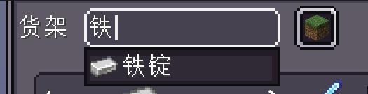
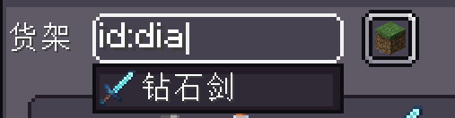
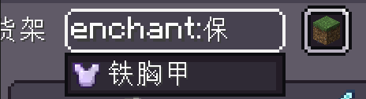
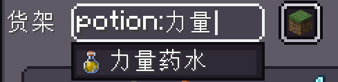
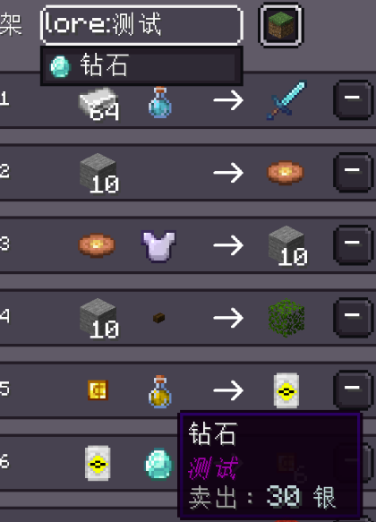
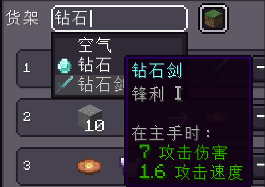

<h1 id="search-optimization" data-toc-id="search-optimization">Search optimization</h1>

  After the v1.0.8 update, this mod optimized the complete item filter input box in the shop UI, inspired by JEI, aiming to solve the search problem for enchantments and potions. However, note that the search scenario for this mod is different from JEI's. For example, JEI won't have various enchantments or carrying descriptions for a diamond sword. Since all the items in the mod's filter pool are added by the creator, the item components will be heavily modified, so in practice, this will happen quite often. That's why I added the concept of conditional filtering to achieve more accurate filtering.

<h2 id="filter-keywords-by-condition" data-toc-id="filter-keywords-by-condition">Filter keywords by condition</h2>

  At this point, some people might wonder: what exactly are filter keywords, and why is such a thing needed? Because an item carries a lot of information—for example, I just wanted to filter by item name, but ended up filtering all spells, potions, or lore that meet the criteria. When the shop has many items, finding them can be quite troublesome, so I added conditional filter terms to provide more precise filtering.

The filters provided by this mod include item name, item ID, spell, potion effect, and description. By default, the filter is, of course, item names

<h2 id="how-to-use-it" data-toc-id="how-to-use-it">How to use it?</h2>

Next, let's explain in detail how to use conditional filtering keywords

<h3 id="name-of-the-item" data-toc-id="name-of-the-item">Name of the item</h3>

By default, the filter is the item name. You don't need to add any prefixes to filter; just enter the name based on your current language to perform a fuzzy search

<h3 id="item-id" data-toc-id="item-id">Item ID</h3>

You need to add a prefix<code>id:</code>, it performs fuzzy queries based on the item ID

<h3 id="a-spell" data-toc-id="a-spell">A spell</h3>

You need to add a prefix<code>enchant:</code>, it performs fuzzy queries based on the item's spell

  
Spell Tips

  

    

      Although we usually talk about enchanting an item, the word 'enchantment' is more like a verb—it's the process of adding spells to items. So here, a more accurate explanation is the spell for judging items, which is the most official translation and can be referenced<a
        href="https://zh.minecraft.wiki/w/%E9%AD%94%E5%92%92" target="_blank"
        rel="noopener noreferrer nofollow">MCWiki's introduction to the spell</a>。

    

      In version 1.21.1, there are two types of enchantments for a single item in the original version. One is:<strong>enchantments, which are "active" enchantments,</strong>The spells on it can produce spell effects, such as the sharpness of the diamond sword, the protection of the iron breastplate, and so on; The other is stored_enchantments, which is an "inactive" spell usually used only for use<a
        href="https://zh.minecraft.wiki/w/%E9%99%84%E9%AD%94%E4%B9%A6"
        target="_blank"
        rel="noopener noreferrer nofollow">Enchantment book</a>Storage enchantments have no effect on their enchantments and are generally only used on anvils. Let's add the enchantments above to our gear.
    

  

<h3 id="potion-inquiry" data-toc-id="potion-inquiry">Potion inquiry</h3>

You need to add a prefix<code>potion:</code>, it performs fuzzy queries based on the effects of potions on items, generally used to distinguish between different potions

<h3 id="description-query" data-toc-id="description-query">Description query</h3>

You need to add a prefix<code>lore:</code>, it will fuzz the query based on the item's description or the content of the item component

<h2 id="a-better-query-experience" data-toc-id="a-better-query-experience">A better query experience</h2>

  If you only go this far, the query experience won't be optimal. When you look up enchantment books, you'll find that the names and textures are the same. If a book has multiple enchantments and each enchantment includes the effect you want to check, it's hard to judge the query effect because you can't tell which enchantment book is which. To solve this, I added a feature: when players hover over these options, I can also show you detailed information about these items, so you don't have to worry about the issues mentioned above.

<h2 id="serial-number-search" data-toc-id="serial-number-search">Serial number search</h2>

  Maybe sharp-eyed people have noticed that there's always a button-like thing on the right side of the image input box above. This thing wasn't available in previous versions either. So what exactly is this thing for? This is the serial number query I will introduce next. Previously, our shop's query only supported item search, and the serial number in every row had limited functionality and space, so we added serial number search to quickly lock onto a specific product. By clicking the button on the right, you can switch between item search and serial number search. Then, in serial number query mode, enter the corresponding product serial number in the input box to filter the product.Such simple content probably doesn't need me to teach you how to use it, right?

