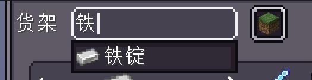
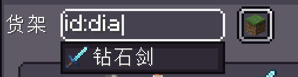
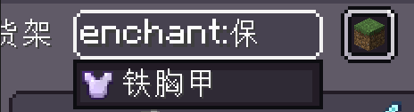
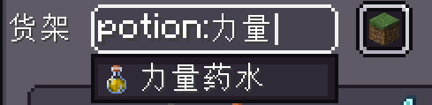
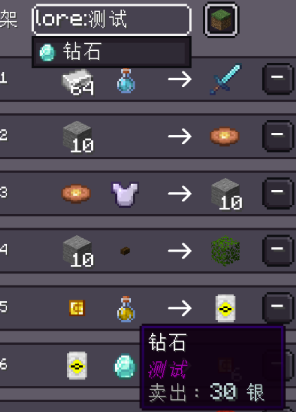
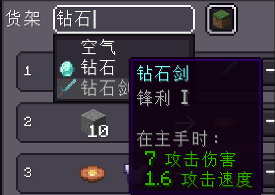

<h1 id="搜索优化" data-toc-id="搜索优化">搜索优化</h1>

  在v1.0.8的更新后，本模组优化了商店UI中物品筛选输入框的补全优化，灵感来自JEI，其目的是为了解决附魔书和药水的搜索问题。但是需要注意的是本模组的搜索场景和JEI的并不一样，比如JEI就不会出现一个钻石剑各种附魔或者携带描述的情况，本模组的筛选池里的物品因为都是作者添加的，其物品的物品组件肯定会有大幅度魔改，所以实际情况下，出现的情况会非常多，所以为此我添加了条件筛选词的概念，就是为了达到更加准确的筛选。

<h2 id="条件筛选词" data-toc-id="条件筛选词">条件筛选词</h2>

  此时就会有人有疑惑了，筛选条件词是啥东西，为什么会需要这种东西？因为一个物品所携带的信息比较多，比如我只是想通过物品名称去筛选，却又把魔咒，药水或者Lore符合条件的全筛选出来的，当商店的物品多的时候找起来会相当麻烦，所以我添加了条件筛选词来提供更加精确的筛选。

本模组提供的筛选包括物品名称，物品id，魔咒，药水效果，描述。而默认情况下的筛选当然是物品名称

<h2 id="如何使用" data-toc-id="如何使用">如何使用？</h2>

那么我们接下来详细说一下我们该如何使用条件筛选词

<h3 id="物品名称" data-toc-id="物品名称">物品名称</h3>

默认情况下的筛选就是物品名称，此时你不需要添加任何前缀就可以进行筛选，根据你当前的语言直接输入名称就可以进行模糊查询

<h3 id="物品id" data-toc-id="物品id">物品id</h3>

你需要添加前缀<code>id:</code>，它会根据物品id来进行模糊查询

<h3 id="魔咒" data-toc-id="魔咒">魔咒</h3>

你需要添加前缀<code>enchant:</code>，它会根据物品的魔咒来进行模糊查询

  
魔咒小知识

  

    

      虽然我们平时都会说一个物品的附魔是啥啥啥的，但是附魔这个词更像是一个动词，是玩家给物品添加魔咒的过程。所以这里更加准确的说法是判断物品的魔咒，这是最为官方的翻译，具体可以参考<a
        href="https://zh.minecraft.wiki/w/%E9%AD%94%E5%92%92" target="_blank"
        rel="noopener noreferrer nofollow">MCWiki关于魔咒的介绍</a>。

    

      在1.21.1版本，原版一个物品的魔咒有两种，一种是<strong>enchantments，这种是"活性"的附魔，</strong>其上的魔咒可以产生魔咒效果，也就是我们常说的钻石剑上的锋利，铁胸甲上的保护等等；另一种是stored_enchantments，这种是“无活性”的魔咒，通常只用于<a
        href="https://zh.minecraft.wiki/w/%E9%99%84%E9%AD%94%E4%B9%A6"
        target="_blank"
        rel="noopener noreferrer nofollow">附魔书</a>存储魔咒，其上的魔咒不会产生效果，一般只用于铁砧让我们把上面的附魔添加到我们的装备上。
    

  

<h3 id="药水查询" data-toc-id="药水查询">药水查询</h3>

你需要添加前缀<code>potion:</code>，它会根据物品的药水效果来进行模糊查询，一般是用于排查各种药水的区别

<h3 id="描述查询" data-toc-id="描述查询">描述查询</h3>

你需要添加前缀<code>lore:</code>，它会根据物品的描述也是lore物品组件的内容去模糊查询

<h2 id="更好的查询体验" data-toc-id="更好的查询体验">更好的查询体验</h2>

  如果只是到这为止的话，其实查询的体验还无法达到最佳，因为当你去查询附魔书的时候，你会发现附魔书的名字和贴图是一样的，如果一个附魔书带有多个附魔，而且这个附魔都包括你要查询的附魔效果，此时这个查询的效果就很难评了，因为你也无法分辨哪个附魔书是哪个。为了解决这个问题，我添加了一个功能：当玩家将鼠标放到这些选项上时，我也可以为你展示这些物品的详细信息，此时你不用担心上面说到的问题了。

<h2 id="序号查询" data-toc-id="序号查询">序号查询</h2>

  也许眼尖的已经注意到了我上面的这些图片输入框的右边一直有一个按钮一样的玩意，这个玩意以前的版本也没有啊，这个玩意到底有啥用呢？这个玩意就是我接下来要介绍的序号查询。在此之前我们商店的查询只有物品查询，而每行都有的序号所能发挥的功能还是太少了还占位，所以为此添加了序号查询来快速锁定某一项商品。我们通过点击右边这个按钮就可以从物品查询和序号查询之间进行切换，然后在序号查询的模式下在输入框输入对应商品的序号就可以进行筛选了。这么简单的内容应该不需要我教你咋用了吧。

