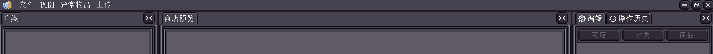
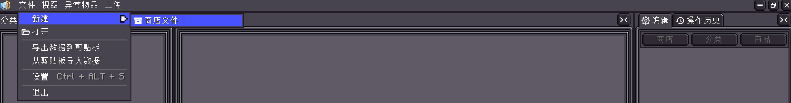
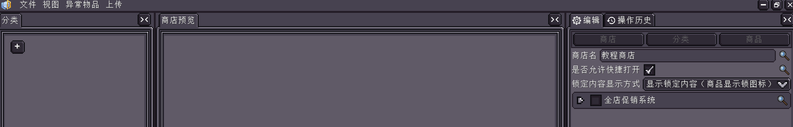
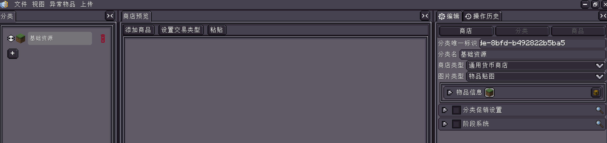
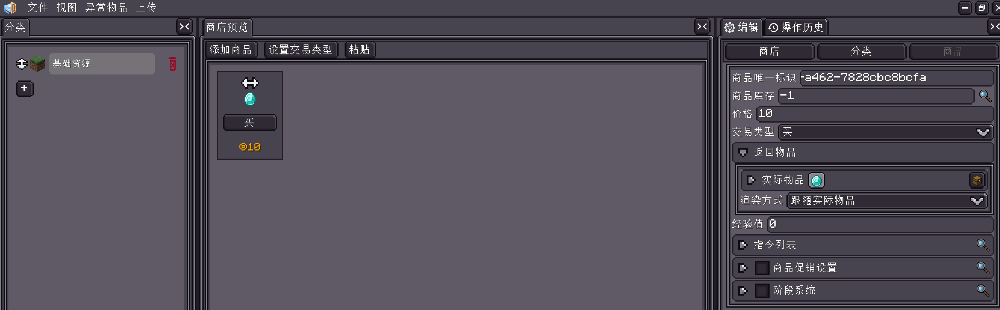
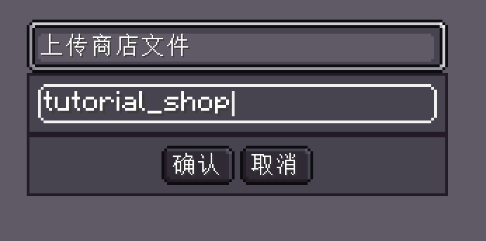
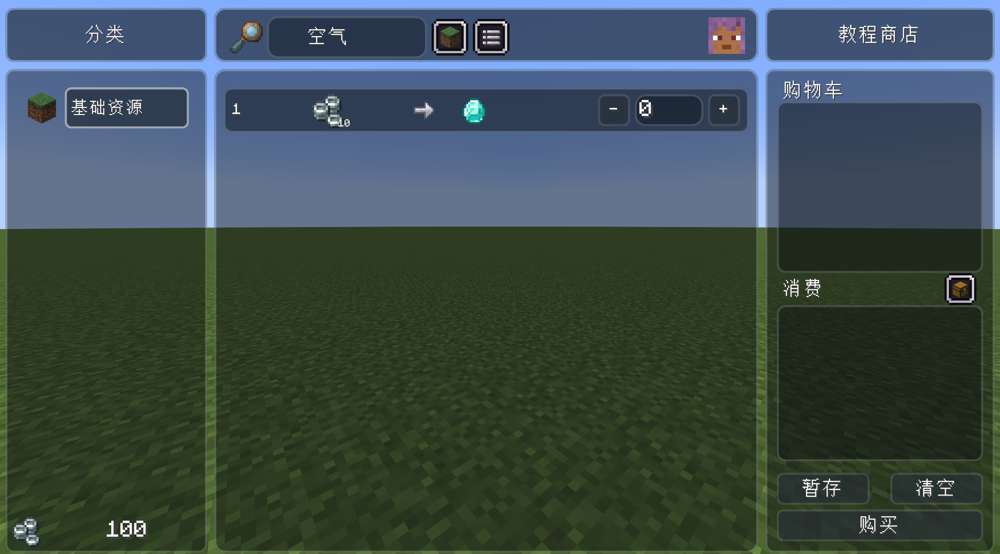
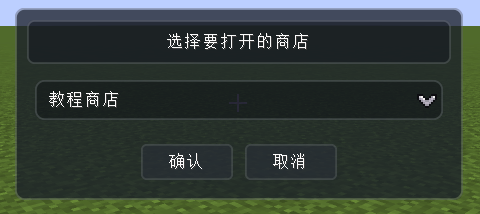

<h1 id="create-your-first-shop" data-toc-id="create-your-first-shop">Create your first shop</h1>

This tutorial walks you through creating a minimal, working general-currency shop in-game: players pay 10◎ to buy 1 diamond. When you are done, you will have mastered the full loop of "open the editor → create a shop → add a category → add an item → upload → test".

  
Prerequisites

  

    
You need a world with ViScriptShop properly loaded and a player with permission level 4. Uploading a shop file also re-checks this permission on the server side.

  

<h2 id="values-to-fill-in" data-toc-id="values-to-fill-in">Values to fill in</h2>
<table data-type="custom-table" data-with-header-row="true"
  style="min-width: 100px;">
  <tbody>
    <tr>
      <th>Location</th>
      <th>Field</th>
      <th>Tutorial value</th>
    </tr>
    <tr>
      <td>Shop</td>
      <td>Shop name</td>
      <td>Tutorial Shop</td>
    </tr>
    <tr>
      <td>Shop</td>
      <td>Allow quick open</td>
      <td>Enabled</td>
    </tr>
    <tr>
      <td>Category</td>
      <td>Category name</td>
      <td>Basic Resources</td>
    </tr>
    <tr>
      <td>Category</td>
      <td>Shop type</td>
      <td>General-currency shop</td>
    </tr>
    <tr>
      <td>Item</td>
      <td>Price</td>
      <td>10</td>
    </tr>
    <tr>
      <td>Item</td>
      <td>Trade type</td>
      <td>Buy</td>
    </tr>
    <tr>
      <td>Item</td>
      <td>Result item</td>
      <td>1 diamond</td>
    </tr>
    <tr>
      <td>Item</td>
      <td>Item stock</td>
      <td>-1</td>
    </tr>
    <tr>
      <td>Upload</td>
      <td>File name</td>
      <td>tutorial_shop</td>
    </tr>
  </tbody>
</table>
<h2 id="steps" data-toc-id="steps">Steps</h2>

  

    
Open the editor

    

      
In-game, type <code>/viscript_shop editor</code>. If the interface does not open, first confirm that you have the server's highest admin permission.
      

    

  

  

    
Create a new shop file

    

      
In the editor, choose <code>File → New → Shop file</code>. In the current version, the <code>.shop</code>
        file is used for both editing and running, so you do not need to export a separate project file.

    

  

  

    
Fill in the shop properties

    

      
The "Edit" panel on the right shows the shop-level fields by default. Set the shop name to
        <code>Tutorial Shop</code> and enable "Allow quick open". Leave the promotion and locked-content display options at their defaults for now.

    

  

  

    
Add a category

    

      
Click the <code>+</code> at the bottom of the category list on the left. With the new category selected, change its name to
        <code>Basic Resources</code>, set the shop type to "General-currency shop", keep the icon type as "Item texture", and pick an easily recognizable item.

    

  

  

    
Add an item

    

      
In the shop preview area in the middle, click "Add item". With the new item selected, set the price to <code>10</code>, choose "Buy" as the trade type, set the result item to 1
        diamond, and leave the stock at <code>-1</code>.

    

  

  

    
Upload to the server

    

      
Choose <code>Upload → Upload shop file</code> and enter <code>tutorial_shop</code> as the file name. Do not type the
        <code>.shop</code> extension manually. Once you receive the success notification saying the shop has been reloaded, the data is ready to be tested right away.

    

  

  

    
Prepare a test balance

    

      
Close the editor and run <code>/viscript_shop money add @s 100</code>. This adds 100◎ of
        test balance to the current player.

    

  

  

    
Open the shop and buy

    

      
Run <code>/viscript_shop open tutorial_shop</code>. Click
        <code>+</code> to the right of the diamond item, confirm that the cart shows 1 diamond and the cost shows 10◎, then click "Buy".

    

  

<h2 id="how-to-verify-success" data-toc-id="how-to-verify-success">How to verify success</h2>
<ul data-type="taskList">
  <li data-checked="false" data-type="taskItem"><label><input
        type="checkbox"></label>
    

      
The shop title shows "Tutorial Shop".

    

  </li>
  <li data-checked="false" data-type="taskItem"><label><input
        type="checkbox"></label>
    

      
The "Basic Resources" category is visible on the left.

    

  </li>
  <li data-checked="false" data-type="taskItem"><label><input
        type="checkbox"></label>
    

      
The item in the middle shows the trade of 10◎ for 1 diamond.

    

  </li>
  <li data-checked="false" data-type="taskItem"><label><input
        type="checkbox"></label>
    

      
After the trade, you get 1 diamond in your inventory and the balance drops from 100◎ to 90◎.

    

  </li>
  <li data-checked="false" data-type="taskItem"><label><input
        type="checkbox"></label>
    

      
This shop appears in the shop-selection UI when you run <code>/viscript_shop open</code>

    

  </li>
</ul>
<h2 id="about-ids-and-file-names" data-toc-id="about-ids-and-file-names">About IDs and file names</h2>

Category IDs and item IDs are auto-generated UUIDs by default, which is fine for normal use. If you need to reference a specific item directly in commands or scripts, you can change them before publishing to stable, space-free values like
  <code>basic_resources</code> or <code>diamond</code>. The shop file name
  <code>tutorial_shop</code> is the shop path used by the open command.

  
Uploading overwrites files with the same name

  

    
Server upload replaces the whole file; it is not real-time multi-user collaboration. When several authors edit at the same time, assign files up front or manage changes with Git.

    
The default "auto-reload shops after upload" makes changes take effect immediately, but it also clears the runtime stock already recorded for that shop. Before uploading to a production server, confirm that resetting the stock to the initial values in the file is acceptable.

  

<h2 id="what-to-learn-next" data-toc-id="what-to-learn-next">What to learn next</h2>

Read <a href="?file=&quot;Editor-Tutorial.Shops-and-Categories&quot;">Shops and Categories</a> to understand all top-level fields, then use <a
    href="?file=&quot;Editor-Tutorial.Items-and-Trades&quot;">Items and Trades</a> to create barter and sell-type items.
