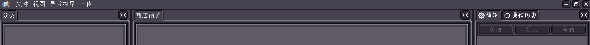
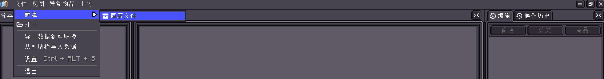
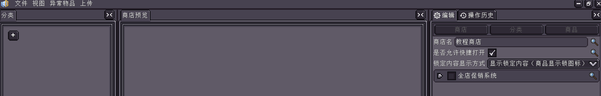
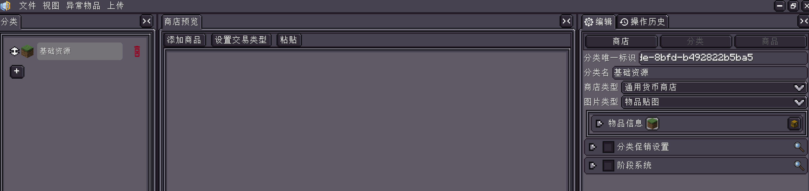
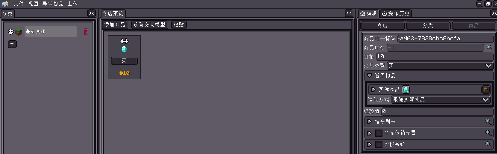
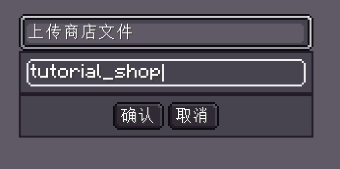
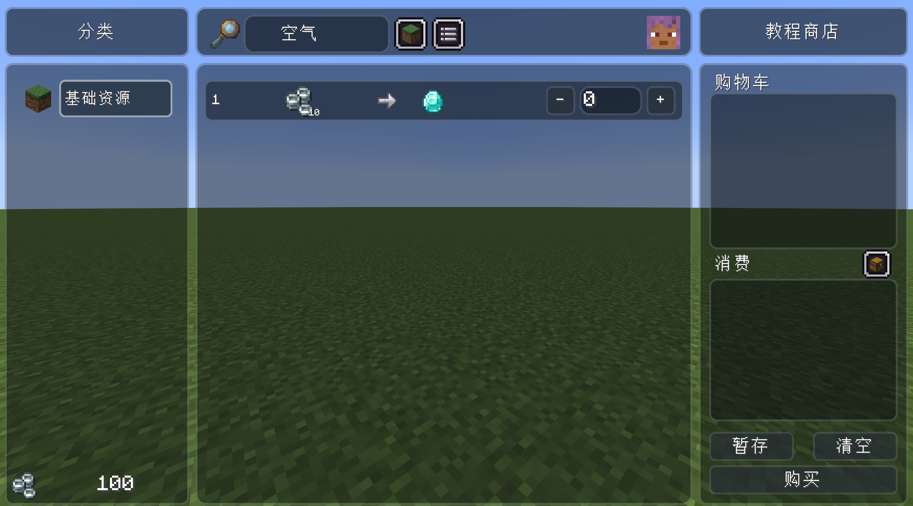
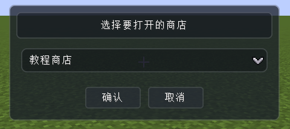

<h1 id="创建第一个商店" data-toc-id="创建第一个商店">创建第一个商店</h1>

本教程会带你在游戏内创建一个最小可用的通用货币商店：玩家花费 10◎ 购买 1
  颗钻石。完成后，你会掌握“打开编辑器→新建商店→添加分类→添加商品→上传→测试”的完整闭环。

  
准备条件

  

    
需要一个已正常加载 ViScriptShop 的世界，以及权限等级 4 的玩家。上传商店文件也会在服务端再次校验该权限。

  

<h2 id="本次要填的值" data-toc-id="本次要填的值">本次要填的值</h2>
<table data-type="custom-table" data-with-header-row="true"
  style="min-width: 100px;">
  <tbody>
    <tr>
      <th>位置</th>
      <th>字段</th>
      <th>教程值</th>
    </tr>
    <tr>
      <td>商店</td>
      <td>商店名</td>
      <td>教程商店</td>
    </tr>
    <tr>
      <td>商店</td>
      <td>是否允许快捷打开</td>
      <td>开启</td>
    </tr>
    <tr>
      <td>分类</td>
      <td>分类名</td>
      <td>基础资源</td>
    </tr>
    <tr>
      <td>分类</td>
      <td>商店类型</td>
      <td>通用货币商店</td>
    </tr>
    <tr>
      <td>商品</td>
      <td>价格</td>
      <td>10</td>
    </tr>
    <tr>
      <td>商品</td>
      <td>交易类型</td>
      <td>买</td>
    </tr>
    <tr>
      <td>商品</td>
      <td>返回物品</td>
      <td>1 颗钻石</td>
    </tr>
    <tr>
      <td>商品</td>
      <td>商品库存</td>
      <td>-1</td>
    </tr>
    <tr>
      <td>上传</td>
      <td>文件名</td>
      <td>tutorial_shop</td>
    </tr>
  </tbody>
</table>
<h2 id="操作步骤" data-toc-id="操作步骤">操作步骤</h2>

  

    
打开编辑器

    

      
在游戏中输入 <code>/viscript_shop editor</code>。如果界面没有打开，先确认自己是否拥有服务器最高管理权限。
      

    

  

  

    
新建商店文件

    

      
在编辑器选择 <code>文件 → 新建 → 商店文件</code>。当前版本的 <code>.shop</code>
        文件同时用于编辑和运行，不需要再导出另一份工程文件。

    

  

  

    
填写商店属性

    

      
右侧“编辑”面板默认显示商店层级字段。将商店名填为
        <code>教程商店</code>，并开启“是否允许快捷打开”。促销和锁定内容显示方式先保持默认。

    

  

  

    
添加分类

    

      
点击左侧分类列表底部的 <code>+</code>。选中新分类后，将名称改为
        <code>基础资源</code>，将商店类型设为“通用货币商店”，图标类型保持“物品贴图”并选一个容易识别的物品。

    

  

  

    
添加商品

    

      
在中间的商店预览区点击“添加商品”。选中新商品，将价格填为 <code>10</code>，交易类型选“买”，返回物品设为 1
        颗钻石，库存保持 <code>-1</code>。

    

  

  

    
上传到服务端

    

      
选择 <code>上传 → 上传商店文件</code>，文件名填写 <code>tutorial_shop</code>。不要手动输入
        <code>.shop</code> 后缀。收到成功通知且显示“已重载商店”时，数据已经可以直接测试。

    

  

  

    
准备测试余额

    

      
关闭编辑器，执行 <code>/viscript_shop money add @s 100</code>。这会给当前玩家增加 100◎
        测试余额。

    

  

  

    
打开并购买

    

      
执行 <code>/viscript_shop open tutorial_shop</code>。在钻石商品右侧点击
        <code>+</code>，确认购物车显示 1 颗钻石、消费显示 10◎，然后点击“购买”。

    

  

<h2 id="如何判断成功" data-toc-id="如何判断成功">如何判断成功</h2>
<ul data-type="taskList">
  <li data-checked="false" data-type="taskItem"><label><input
        type="checkbox"></label>
    

      
商店标题显示“教程商店”。

    

  </li>
  <li data-checked="false" data-type="taskItem"><label><input
        type="checkbox"></label>
    

      
左侧可以看到“基础资源”分类。

    

  </li>
  <li data-checked="false" data-type="taskItem"><label><input
        type="checkbox"></label>
    

      
中间商品显示 10◎ 到 1 颗钻石的交易关系。

    

  </li>
  <li data-checked="false" data-type="taskItem"><label><input
        type="checkbox"></label>
    

      
成交后背包获得 1 颗钻石，余额从 100◎ 变为 90◎。

    

  </li>
  <li data-checked="false" data-type="taskItem"><label><input
        type="checkbox"></label>
    

      
使用<code>/viscript_shop open</code>打开选择商店的UI时可以看到这个UI

    

  </li>
</ul>
<h2 id="关于-id-和文件名" data-toc-id="关于-id-和文件名">关于 ID 和文件名</h2>

分类 ID 和商品 ID 默认是自动生成的 UUID，这不影响使用。如果你会在指令或脚本中直达某个商品，可以在发布前改成
  <code>basic_resources</code>、<code>diamond</code> 这类稳定且无空格的值。商店文件名
  <code>tutorial_shop</code> 则是打开指令使用的商店路径。

  
上传会覆盖同名文件

  

    
服务端上传是整个文件覆盖，不是多人实时协作。多个作者同时编辑时，应先分配文件或使用 Git 管理修改。

    
默认的“上传后自动重载商店”会让修改立即生效，但也会清除该商店已记录的运行时库存。正式服务器上传前请先确认是否允许库存回到文件中的初始值。

  

<h2 id="接下来学什么" data-toc-id="接下来学什么">接下来学什么</h2>

阅读<a href="?file=&quot;编辑器教程.商店与分类&quot;">商店与分类</a>理解所有顶层字段，再通过<a
    href="?file=&quot;编辑器教程.商品与交易&quot;">商品与交易</a>创建以物换物和出售型商品。
