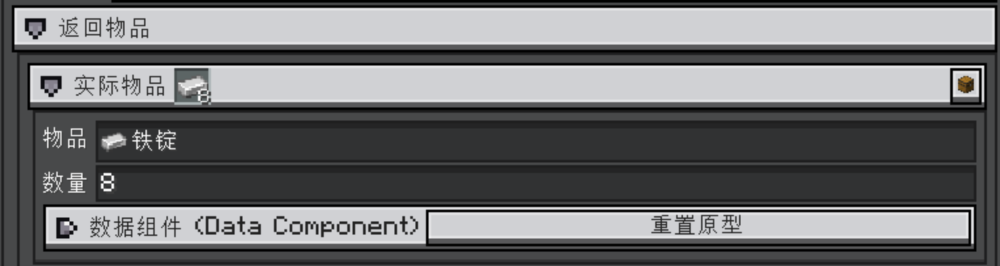
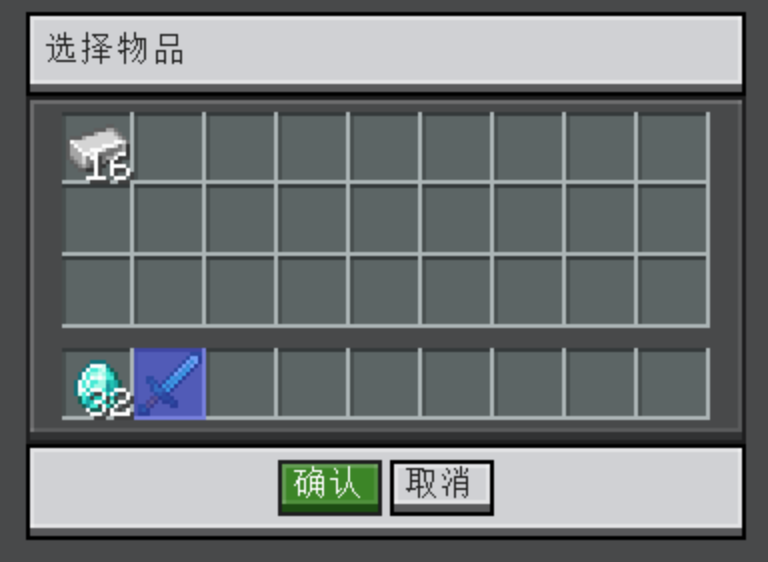
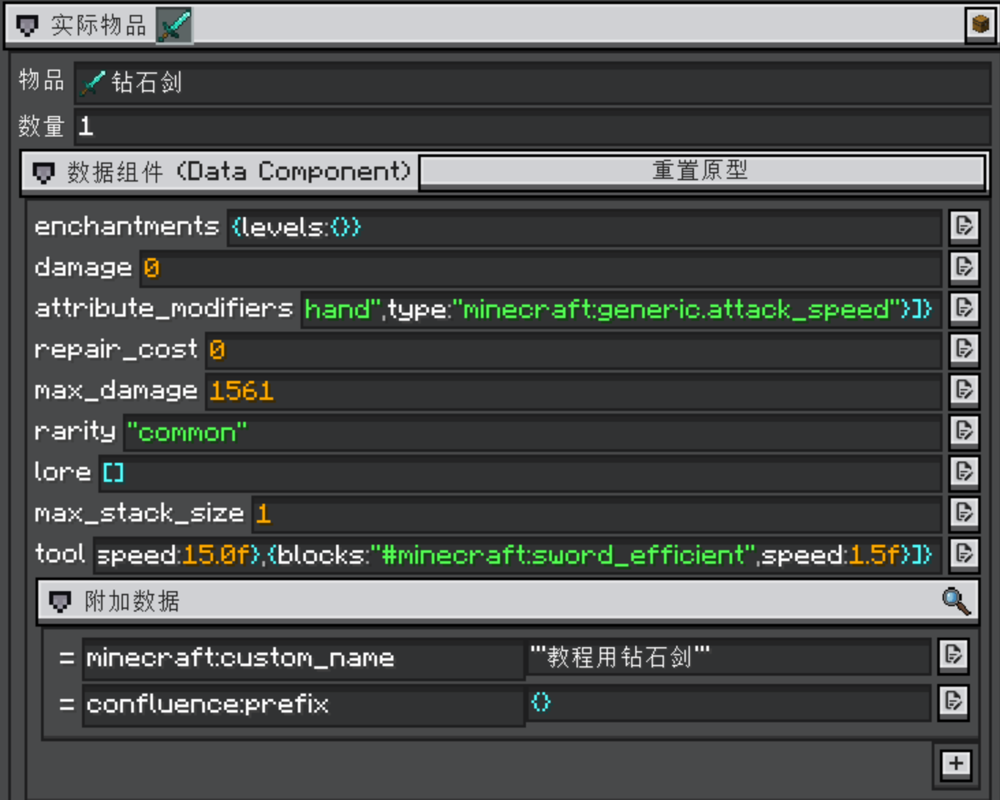
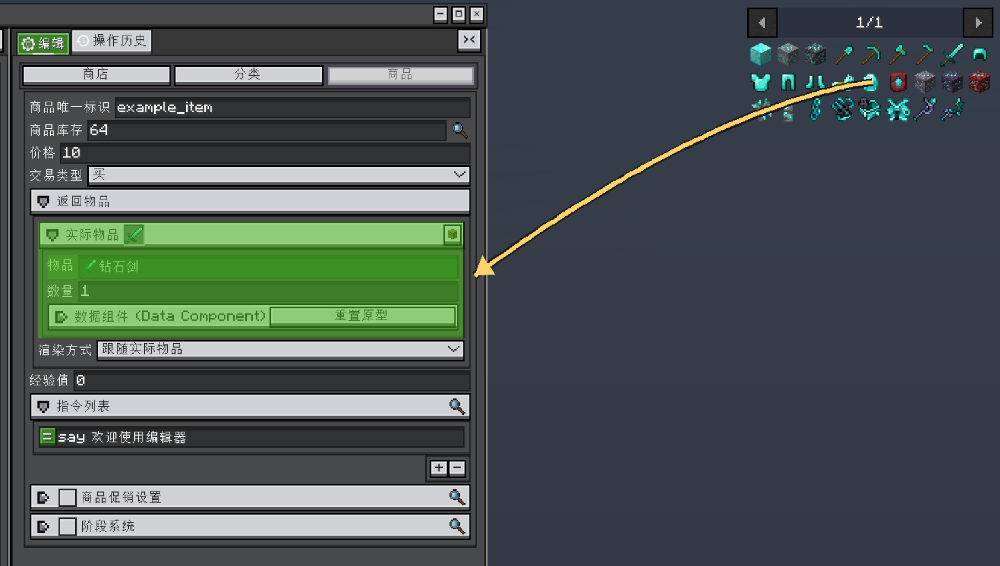

<h1 id="common-editor-components" data-toc-id="common-editor-components">Common editor components</h1>

ViScript editors reuse typed fields and search controls. Learn how each control commits its value before changing a large project. The same controls appear in AI connection settings.

<h2 id="numbers-and-text" data-toc-id="numbers-and-text">Numbers and text</h2>

Click a field to focus it. After focusing a numeric field, use the wheel or drag the number horizontally; Shift speeds adjustment. Fields can restrict their allowed range. Enter the value and confirm or leave the field as its editor requires. A displayed unit such as ticks or a count belongs to that particular field.

<h2 id="item-stacks-and-inventory-samples" data-toc-id="item-stacks-and-inventory-samples">Item stacks and inventory samples</h2>

An item-type field selects an item ID. An item-stack form also holds its count and components. Expand the stack to edit those details; check the icon and full ID after selection.

The chest button opens a selector for your inventory. Select a nonempty slot and Confirm, or double-click to confirm it directly. This copies stack data without taking, moving or consuming the inventory item. Prepare an enchanted or named sample first when those components matter.

<h2 id="drag-from-an-item-browser" data-toc-id="drag-from-an-item-browser">Drag from an item browser</h2>

Where the editor and installed JEI/EMI/REI integration support it, drag an item icon from the browser onto a compatible item field or stack form. Use the browser inside the game window; an attached game overlay does not automatically move into an independent desktop editor. Inspect the selected stack and save afterward.

<h2 id="search-and-select" data-toc-id="search-and-select">Search and select</h2>

Enter a search

Type an ID, ID fragment or supported localized name. Wait for the candidates to update.

Choose a candidate

Click the intended result. Typing text alone does not always commit a typed object selection.

Check the selected value

Verify the complete namespace and ID. Counts, stack components and other parameters are usually separate fields.

<table data-type="custom-table" data-with-header-row="true" style="min-width: 100px;">
<tbody>
<tr><th>Selector</th><th>Search behavior</th><th>Meaning</th></tr>
<tr><td>Item, block, fluid, entity type</td><td>ID or supported localized name</td><td>Selects a registered type, not a particular entity or world position.</td></tr>
<tr><td>Biome, enchantment, damage type</td><td>Loaded registry IDs and supported names</td><td>Some registries depend on the connected world and synchronized data.</td></tr>
<tr><td>Structure</td><td>Structure ID/type ID and ID fragments</td><td>Selects a structure type, not the coordinates of an existing structure.</td></tr>
<tr><td>Dimension</td><td>Dimension ID, such as minecraft:the_nether</td><td>Use the ID; a localized name is not a substitute in this field.</td></tr>
<tr><td>Sound event and particle type</td><td>Registered ID or ID fragments</td><td>Does not by itself preview a sound or configure particle parameters.</td></tr>
<tr><td>Attribute and status effect</td><td>ID or supported name</td><td>Value, level and duration are configured elsewhere.</td></tr>
</tbody>
</table>
<h2 id="tags" data-toc-id="tags">Tags</h2>

In VSL tag selectors, enter a tag ID such as <code>minecraft:planks</code> without a leading <code>#</code>, then choose the candidate. Selecting a tag selects its group of members; cycling icons are only a preview. Item and block tags with the same ID are still different types.

Tag selectors and AI queries differ

The ordinary tag field omits #. In AI chat, a request such as “query members of #minecraft:logs” explicitly asks the registry tool to inspect a tag. Use the format required by the control or tool you are using.

<h2 id="loaded-json-resources-and-missing-items" data-toc-id="loaded-json-resources-and-missing-items">Loaded JSON resources and missing items</h2>

JSON resource selectors search an editor-defined directory in loaded datapack or resource-pack data. They do not browse arbitrary files or search JSON contents. A file such as <code>data/test/chatbox/dialogues/example.json</code> is selected as <code>test:chatbox/dialogues/example</code> when that directory is supported.

A missing-item selector only lists unresolved IDs recorded by the current project. Use a normal item selector when choosing a replacement. Replacing a placeholder overwrites the original unresolved reference.

<h2 id="toggles-and-fixed-choices" data-toc-id="toggles-and-fixed-choices">Toggles and fixed choices</h2>

A toggle changes whether an option is enabled. A group may have both a disclosure arrow and a toggle: collapsing the group does not disable it. A fixed-choice dropdown accepts one of its listed options; it is different from a searchable typed-object field.

<h2 id="lists-and-ordering" data-toc-id="lists-and-ordering">Lists and ordering</h2>
<table data-type="custom-table" data-with-header-row="true" style="min-width: 100px;">
<tbody>
<tr><th>Action</th><th>Control</th></tr>
<tr><td>Add</td><td>Use + at the end of a list, then edit the new entry.</td></tr>
<tr><td>Remove</td><td>Select an entry, then use the available − control.</td></tr>
<tr><td>Reorder</td><td>Drag the = handle beside an entry.</td></tr>
<tr><td>Scroll</td><td>Use the wheel or scrollbar; dragging a reorder handle changes the order.</td></tr>
</tbody>
</table>

Controls appear only when the owning list permits the operation. A selected entry may still be protected from deletion.

<h2 id="colors-and-copy-operations" data-toc-id="colors-and-copy-operations">Colors and copy operations</h2>

Click a color swatch to open its picker. Where an eight-digit hex field is provided, <code>#AARRGGBB</code> starts with alpha, for example <code>#ff55aaff</code>. Check opacity when the result appears invisible. Plain string fields can use a different format.

Ctrl/Cmd+A, C, X and V act on focused text. Some typed fields also expose an internal copy/paste context menu, which only works with compatible field types. Move focus back to the canvas before using object-level shortcuts.

Field edits update the current project. Save them through the <a href="?file=&quot;Editor-Basics&quot;">normal file workflow</a>.

Related guides: <a href="?file=&quot;Learning Path&quot;">Learning Path</a> · <a href="?file=&quot;Editor-Basics&quot;">Editor-Basics</a> · <a href="?file=&quot;Editor.Desktop Windows and Layout&quot;">Desktop Windows and Layout</a> · <a href="?file=&quot;AI.Connection and Edit Preferences&quot;">Connection and Edit Preferences</a> · <a href="?file=&quot;Troubleshooting and Saving&quot;">Troubleshooting and Saving</a>

