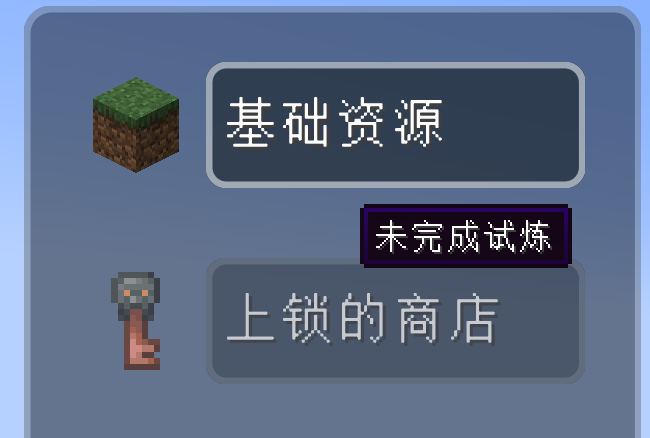
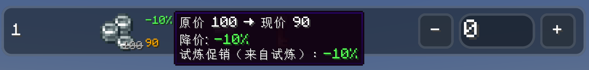
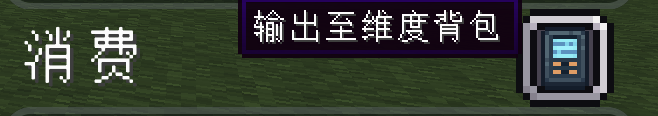
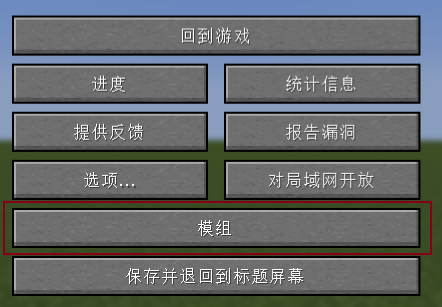
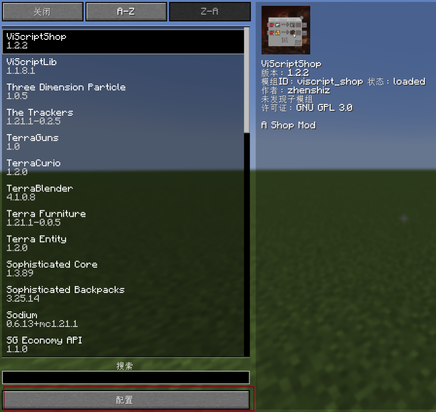
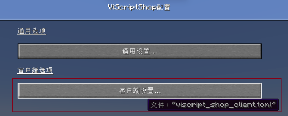
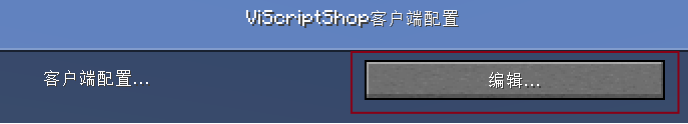
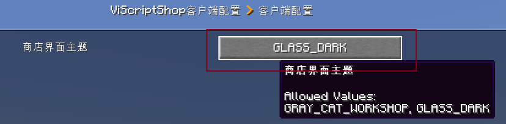

<h1 id="player-buying-guide" data-toc-id="player-buying-guide">Player Buying Guide</h1>

This page is aimed at regular players using the shop, explaining how to find items, adjust quantities, check costs, stash the cart, and complete checkout. Modpacks may use NPCs, quest rewards, buttons, or the FTB
  sidebar as entry points; the actual setup depends on the server's design.

<h2 id="opening-the-shop" data-toc-id="opening-the-shop">Opening the Shop</h2>
<ul>
  <li>
    
<strong>Modpack entry:</strong> Interact with an NPC or click a button provided by the modpack author.

  </li>
  <li>
    

      <strong>FTB Library sidebar:</strong> Once the server enables the shortcut button, click "Open Shop". Admins can make the button open a specific shop directly, or show the shop selector first.
    

  </li>
  <li>
    
<strong>Command:</strong><code>/viscript_shop open &lt;shop path&gt;</code>
      opens the specified shop, but this command requires permission level 2; regular players normally use the entry points above.

  </li>
</ul>
<h2 id="interface-sections" data-toc-id="interface-sections">Interface Sections</h2>
<table data-type="custom-table" data-with-header-row="true"
  style="min-width: 100px;">
  <tbody>
    <tr>
      <th>Area</th>
      <th>Purpose</th>
      <th>Usage Tips</th>
    </tr>
    <tr>
      <td>Category list</td>
      <td>Switch item categories</td>
      <td>Locked categories have dimmed names and icons; hovering only shows the unlock condition</td>
    </tr>
    <tr>
      <td>Item area</td>
      <td>View trade relations and adjust quantities</td>
      <td>Locked items show a locked hint and no editable quantity controls</td>
    </tr>
    <tr>
      <td>Cart</td>
      <td>Summarizes the items or currency you will receive this time</td>
      <td>Freebies use a separate "Free" tag</td>
    </tr>
    <tr>
      <td>Cost area</td>
      <td>Summarizes the items to be deducted and the net currency cost</td>
      <td>Green means currently sufficient, red means insufficient</td>
    </tr>
    <tr>
      <td>Action buttons</td>
      <td>Stash, clear, and buy</td>
      <td>Buying is the final checkout; other actions do not charge anything</td>
    </tr>
  </tbody>
</table>
<h2 id="completing-a-purchase" data-toc-id="completing-a-purchase">Completing a Purchase</h2>

  

    
Select a Category

    

      
Click an unlocked category on the left. If a category is dimmed and cannot be selected, hover over its name or icon to see the unlock condition.

      

    

  

  

    
Find an Item

    

      
Use the search box at the top to search by item, or switch to "Index Search" and enter the index number shown on the left of the item card. The search matches both output items and the cost items of barter trades.

    

  

  

    
Adjust Quantity

    

      
Use <code>-</code>, the quantity field, or <code>+</code> to adjust trade counts. Finite stock limits the quantity. Hold Ctrl (Cmd on macOS) and click <code>+</code> to calculate the maximum affordable quantity using available items, balance, the cart, and promotions, within remaining stock. If you cannot pay, the quantity becomes 0.

    

  

  

    
Check Gains and Costs

    

      
The cart in the upper right shows the output, while the cost area below shows the cost. Actual promotional prices are reflected directly in both areas; hover over the adjusted price to see the full "original price →
        current price" values (with thousands separators), the "increase/decrease" magnitude (increases in red, decreases in green), and the details of each promotion rule.

    

  

  

    
Choose Output Target

    

      
Click the output target button near the cost header to switch between registered output locations. The default is the player inventory; if the "Beyond Dimensions" mod is installed and the player has unlocked the dimensional backpack, the dimensional network can also be selected.
      

    

  

  

    
Submit Checkout

    

      
Click "Buy". The server re-validates stock, phases, promotion conditions, balance, items, and the output target; only after all checks pass are costs deducted and output granted.

    

  

<h2 id="quantity-shortcuts" data-toc-id="quantity-shortcuts">Quantity Shortcuts</h2><table data-type="custom-table" data-with-header-row="true" style="min-width: 100px;"><tbody><tr><th>Action</th><th>Effect</th></tr><tr><td>Click + / -</td><td>Increase / decrease by 1 trade</td></tr><tr><td>Shift + click + / -</td><td>Increase / decrease by 10 trades, within stock and the zero lower bound</td></tr><tr><td>Ctrl / Cmd + click +</td><td>Set the maximum affordable quantity within remaining stock</td></tr><tr><td>Ctrl / Cmd + click -</td><td>Clear this item quantity</td></tr><tr><td>Quantity field</td><td>Enter a trade count directly; finite stock limits the input</td></tr></tbody></table>
Quantity counts <strong>trades</strong>, rather than individual items. If one trade exchanges 2 emeralds for 4 bread, two trades cost 4 emeralds and yield 8 bread. Regular clicks and direct input can select more than you can afford; the cost panel then shows the shortage. Only Buy submits a purchase.

The maximum uses the resource snapshot synchronized with the open screen. It does not reserve stock. Other players, inventory changes, and promotion changes may affect the result; the server validates everything again at checkout.

<figure data-type="local-video" data-width="960" style="width: 960px; max-width: 100%;"><video src="/md/media/viscriptshop-quantity-checkout-en.mp4" poster="/md/media/viscriptshop-quantity-checkout-en.png" controls playsinline preload="metadata"><a href="/md/media/viscriptshop-quantity-checkout-en.mp4">Open video</a></video><figcaption>Live UI demonstration: trade counts, maximum quantity, clear, and checkout (about 20 seconds, English captions)</figcaption></figure>
<h2 id="search-and-layout" data-toc-id="search-and-layout">Search and Layout</h2>
<ul>
  <li>
    
The toggle button next to the magnifying glass switches between "Item Search" and "Index Search".

  </li>
  <li>
    
The generic currency category can be toggled between list and grid layouts; the choice is saved as the current player's preference.

  </li>
  <li>
    
If JEI is installed, hover over an item icon in the item area and press the JEI-bound recipe or usage keys to look it up.

  </li>
  <li>
    
If Just Enough Characters is installed, the item search box supports Pinyin input.

  </li>
  <li>
    
For detailed purchase-condition filtering, see <a href="?file=&quot;Search-Optimization&quot;">Search Optimization</a>

  </li>
</ul>
<h2 id="stash-and-clear" data-toc-id="stash-and-clear">Stash and Clear</h2>
<ul>
  <li>
    
<strong>Stash:</strong> Keeps the current purchase quantity of each item and closes the shop. The next time the shop is opened, it tries to restore them by category ID and item ID,
      and clamps quantities to the latest stock limits.

  </li>
  <li>
    
<strong>Clear:</strong> Sets the quantity of every item in the current cart to zero; no checkout is triggered.

  </li>
</ul>
<h2 id="virtual-currency-offset-rules" data-toc-id="virtual-currency-offset-rules">Virtual Currency Offset Rules</h2>

Within the same cart, virtual currency earned from selling items is first netted against the virtual currency spent on buying items.

<table data-type="custom-table" data-with-header-row="true"
  style="min-width: 100px;">
  <tbody>
    <tr>
      <th>Cart contents</th>
      <th>Final settlement</th>
      <th>Requirement on initial balance</th>
    </tr>
    <tr>
      <td>Buy costs 200◎, sell earns 100◎</td>
      <td>Net cost 100◎</td>
      <td>At least 100◎ required</td>
    </tr>
    <tr>
      <td>Buy costs 100◎, sell earns 200◎</td>
      <td>Net gain 100◎</td>
      <td>Can start from 0◎</td>
    </tr>
    <tr>
      <td>Buy costs 100◎, sell earns 100◎</td>
      <td>Balance unchanged</td>
      <td>Can start from 0◎</td>
    </tr>
  </tbody>
</table>

  
Items Do Not Offset Each Other in the Cart

  

    
If trade A in the cart produces 1 diamond and trade B requires 1 diamond as a cost, the player must still already hold that 1
      diamond before checkout. Output items are only granted after cost validation and deduction are complete.

  

<h2 id="what-to-do-when-checkout-fails" data-toc-id="what-to-do-when-checkout-fails">What to Do When Checkout Fails</h2>
<ul>
  <li>
    
"Not enough balance": Reduce the quantity, or add sell trades that earn virtual currency to the same cart.

  </li>
  <li>
    
"Not enough items": Check whether the items' components, durability, and custom data match the shop's matching rules.

  </li>
  <li>
    
"Insufficient stock": On multiplayer servers, other players may have bought the item first after you opened the UI. After a failure, the UI syncs the latest stock.

  </li>
</ul>
<h2 id="content-scale" data-toc-id="content-scale">Content Scale</h2>
Set <code>shopContentScale</code> in the <code>[client]</code> section of <code>config/viscript_shop_client.toml</code> if shop content looks too large or small. The default is <code>1.0</code>; the range is <code>0.5</code> to <code>1.5</code>. Smaller values fit more content; larger values improve readability. This is independent of vanilla GUI scale. Reopen the shop after changing it.
<pre language="toml" isclosed="false"><code class="language-toml">[client]
shopUiTheme = "GLASS_DARK"
shopContentScale = 0.85</code></pre>
<h2 id="ui-themes" data-toc-id="ui-themes">UI Themes</h2>

Two client themes are currently supported: "Dark Glass" and "Gray Cat Workshop". The main shop UI, the shop selector, and message popups such as the purchase-success dialog all share the current theme. The theme is determined by each player's own
  <code>viscript_shop_client.toml</code> and does not affect server trade rules.

If you are using 1.21.1 NeoForge, it ships with a native visual config editor UI. Here is how to use it:

  

    
Step 1

    

  

  

    
Step 2

    

  

  

    
Step 3

    

  

  

    
Step 4

    

  

  

    
Step 5

    

  

