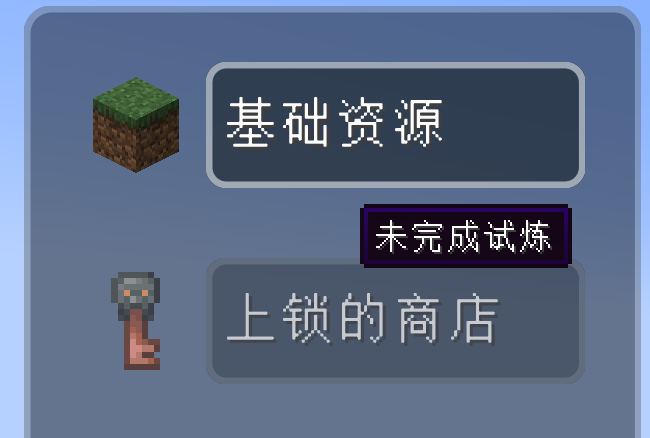
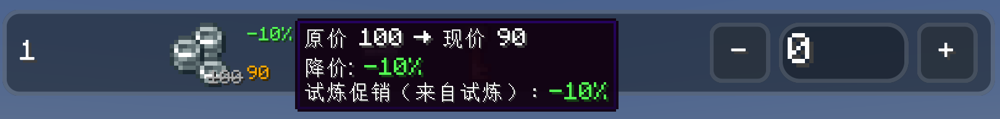
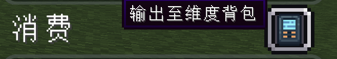
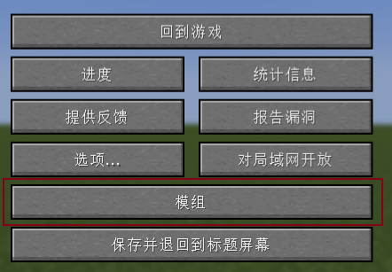
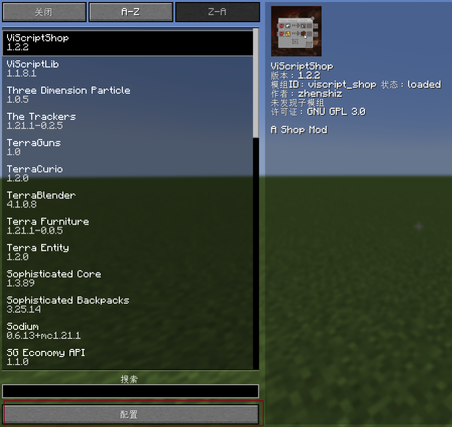
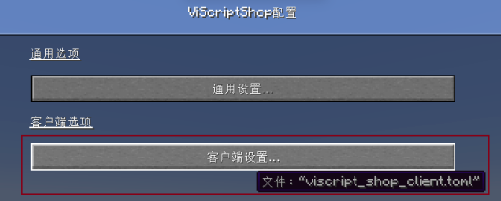
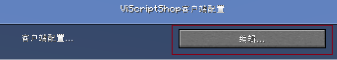
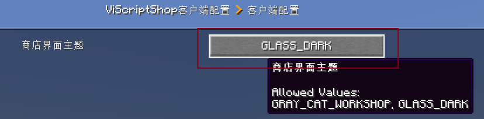

<h1 id="玩家购买指南" data-toc-id="玩家购买指南">玩家购买指南</h1>

本页面向使用商店的普通玩家，介绍如何找到商品、调整数量、检查消费、暂存购物车并完成结算。整合包可能用 NPC、任务奖励、按钮或 FTB
  侧边栏作为入口，具体以服务器设计为准。

<h2 id="打开商店" data-toc-id="打开商店">打开商店</h2>
<ul>
  <li>
    
<strong>整合包入口：</strong>与 NPC 交互或点击整合包作者提供的按钮。

  </li>
  <li>
    

      <strong>FTB Library 侧边栏：</strong>服务器开启快捷按钮后，点击“打开商店”。管理员可以让按钮直接打开某一家店，也可以先显示商店选择器。
    

  </li>
  <li>
    
<strong>指令：</strong><code>/viscript_shop open &lt;商店路径&gt;</code>
      可打开指定商店，但该指令需要权限等级 2，普通玩家通常由上述入口打开。

  </li>
</ul>
<h2 id="界面分区" data-toc-id="界面分区">界面分区</h2>
<table data-type="custom-table" data-with-header-row="true"
  style="min-width: 100px;">
  <tbody>
    <tr>
      <th>区域</th>
      <th>作用</th>
      <th>使用要点</th>
    </tr>
    <tr>
      <td>分类列表</td>
      <td>切换商品分类</td>
      <td>已锁定分类会降低名称和图标亮度，悬停只显示解锁条件</td>
    </tr>
    <tr>
      <td>商品区</td>
      <td>查看交易关系和调整数量</td>
      <td>未解锁商品显示锁定提示，不显示可编辑的数量控件</td>
    </tr>
    <tr>
      <td>购物车</td>
      <td>汇总本次将要获得的物品或货币</td>
      <td>赠品会使用独立的“赠”标识</td>
    </tr>
    <tr>
      <td>消费区</td>
      <td>汇总本次将要扣除的物品和净货币支出</td>
      <td>绿色表示当前足够，红色表示不足</td>
    </tr>
    <tr>
      <td>操作按钮</td>
      <td>暂存、清空和购买</td>
      <td>购买是最终结算，其他操作不会扣费</td>
    </tr>
  </tbody>
</table>
<h2 id="完成一次购买" data-toc-id="完成一次购买">完成一次购买</h2>

  

    
选择分类

    

      
在左侧点击已解锁的分类。如果分类变暗且无法选中，将鼠标悬停在名称或图标上查看解锁条件。

      

    

  

  

    
找到商品

    

      
使用顶部搜索框按物品查询，或切换为“序号查询”后输入商品卡片左侧的序号。搜索会同时匹配输出物品和以物换物的成本物品。

    

  

  

    
调整数量

    

      
使用 <code>-</code>、数量输入框或 <code>+</code> 调整交易份数。有限库存商品不能超过剩余库存；按住 Ctrl（macOS 上为 Cmd）点击 <code>+</code>，会根据当前可用物品、余额、购物车和促销计算可购买的最大份数，并受剩余库存限制。无法支付时会设为 0。

    

  

  

    
检查收益与消费

    

      
右侧上方的购物车显示产出，下方的消费显示成本。实际促销价会直接反映在这两个区域中；悬停调整后的价格可查看“原价 →
        现价”的完整数值（带千分位）、“涨价/降价”幅度（涨价为红色、降价为绿色）以及每条促销规则的明细。

    

  

  

    
选择输出目标

    

      
点击消费标题附近的输出目标按钮，可在已注册的输出位置之间切换。默认为玩家背包；安装“超越维度”且玩家已开通维度背包时，还可选择维度网络。
      

    

  

  

    
提交结算

    

      
点击“购买”。服务端会重新校验库存、阶段、促销条件、余额、物品和输出目标；全部通过后才会扣除成本并发放产出。

    

  

<h2 id="数量快捷操作" data-toc-id="数量快捷操作">数量快捷操作</h2><table data-type="custom-table" data-with-header-row="true" style="min-width: 100px;"><tbody><tr><th>操作</th><th>效果</th></tr><tr><td>点击 + / -</td><td>增加 / 减少 1 份</td></tr><tr><td>Shift + 点击 + / -</td><td>增加 / 减少 10 份，仍受库存和零下限约束</td></tr><tr><td>Ctrl / Cmd + 点击 +</td><td>设置为当前可支付且库存允许的最大份数</td></tr><tr><td>Ctrl / Cmd + 点击 -</td><td>将这件商品的数量清零</td></tr><tr><td>数量输入框</td><td>直接填写交易份数，有限库存会限制输入上限</td></tr></tbody></table>
数量表示<strong>交易份数</strong>，不一定是物品个数。例如每份用 2 颗绿宝石换 4 个面包，选择 2 份就是消费 4 颗绿宝石、获得 8 个面包。普通加减或直接输入允许先选超出支付能力的数量，此时消费区会提示不足；点击“购买”才会结算。

“最大数量”基于打开界面后同步的资源快照，不是预留库存或购买保证。其他玩家购买、背包变化和促销条件变化都可能影响结果；服务端仍会在结算时重新校验。

<figure data-type="local-video" data-width="960" style="width: 960px; max-width: 100%;"><video src="/md/media/viscriptshop-quantity-checkout-zh.mp4" poster="/md/media/viscriptshop-quantity-checkout-zh.png" controls playsinline preload="metadata"><a href="/md/media/viscriptshop-quantity-checkout-zh.mp4">打开视频</a></video><figcaption>真实操作演示：交易份数、最大数量、清空与结算（约 20 秒，含中文字幕）</figcaption></figure>
<h2 id="搜索与布局" data-toc-id="搜索与布局">搜索与布局</h2>
<ul>
  <li>
    
放大镜旁的切换按钮可在“物品查询”和“序号查询”之间切换。

  </li>
  <li>
    
通用货币分类可在列表和网格布局之间切换；选择会保存为当前玩家的偏好。

  </li>
  <li>
    
如果安装 JEI，可将鼠标放在商品区的物品图标上，按 JEI 已绑定的配方或用途键查询。

  </li>
  <li>
    
如果安装 Just Enough Characters，商品搜索框支持拼音查询。

  </li>
  <li>
    
详细的购买条件筛选可以参考<a href="?file=&quot;搜索优化&quot;">搜索优化</a>

  </li>
</ul>
<h2 id="暂存与清空" data-toc-id="暂存与清空">暂存与清空</h2>
<ul>
  <li>
    
<strong>暂存：</strong>保留当前各商品的购买数量并关闭商店。之后打开商店时，会按分类 ID 和商品 ID
      尝试恢复，且会将数量压到最新库存上限内。

  </li>
  <li>
    
<strong>清空：</strong>把当前购物车中所有商品的数量归零，不会发起结算。

  </li>
</ul>
<h2 id="虚拟货币抵扣规则" data-toc-id="虚拟货币抵扣规则">虚拟货币抵扣规则</h2>

同一辆购物车中，出售商品得到的虚拟货币会与购买商品的虚拟货币支出先做净额抵扣。

<table data-type="custom-table" data-with-header-row="true"
  style="min-width: 100px;">
  <tbody>
    <tr>
      <th>购物车内容</th>
      <th>最终结算</th>
      <th>对初始余额的要求</th>
    </tr>
    <tr>
      <td>购买支出 200◎，出售获得 100◎</td>
      <td>净支出 100◎</td>
      <td>至少需要 100◎</td>
    </tr>
    <tr>
      <td>购买支出 100◎，出售获得 200◎</td>
      <td>净获得 100◎</td>
      <td>可以从 0◎ 开始</td>
    </tr>
    <tr>
      <td>购买支出 100◎，出售获得 100◎</td>
      <td>余额不变</td>
      <td>可以从 0◎ 开始</td>
    </tr>
  </tbody>
</table>

  
物品不会在购物车内相互抵扣

  

    
如果购物车中的交易 A 会产出 1 颗钻石，交易 B 又要求 1 颗钻石作为成本，玩家在结算前仍然必须已经持有这 1
      颗钻石。产出物品只会在成本校验和扣除完成后发放。

  

<h2 id="结算失败时怎么办" data-toc-id="结算失败时怎么办">结算失败时怎么办</h2>
<ul>
  <li>
    
“余额不够”：减少数量，或在同一购物车中加入可获得虚拟货币的出售商品。

  </li>
  <li>
    
“物品数量不够”：检查物品的组件、耐久、自定义数据是否符合商店匹配规则。

  </li>
  <li>
    
“库存不足”：在多人服务器中，其他玩家可能在你打开界面后先买走了商品。失败后界面会同步最新库存。

  </li>
</ul>
<h2 id="内容缩放" data-toc-id="内容缩放">内容缩放</h2>
若商品显得过大或显示内容偏少，可在客户端配置 <code>config/viscript_shop_client.toml</code> 的 <code>[client]</code> 段设置 <code>shopContentScale</code>。默认 <code>1.0</code>，范围 <code>0.5</code> 到 <code>1.5</code>；减小可容纳更多内容，增大便于看清商品。它独立于原版 GUI 缩放，修改后重新打开商店生效。
<pre language="toml" isclosed="false"><code class="language-toml">[client]
shopUiTheme = "GLASS_DARK"
shopContentScale = 0.85</code></pre>
<h2 id="界面主题" data-toc-id="界面主题">界面主题</h2>

当前支持“深色玻璃”和“灰猫工坊”两种客户端主题。商店主界面、商店选择器和购买成功等消息弹窗会共享当前主题。主题由每位玩家自己的
  <code>viscript_shop_client.toml</code> 决定，不影响服务器交易规则。

如果你使用的1.21.1NeoForge，原生自带一个可视化编辑配置UI，操作方法如下：

  

    
第一步

    

  

  

    
第二步

    

  

  

    
第3步

    

  

  

    
第4步

    

  

  

    
第5步

    

  

