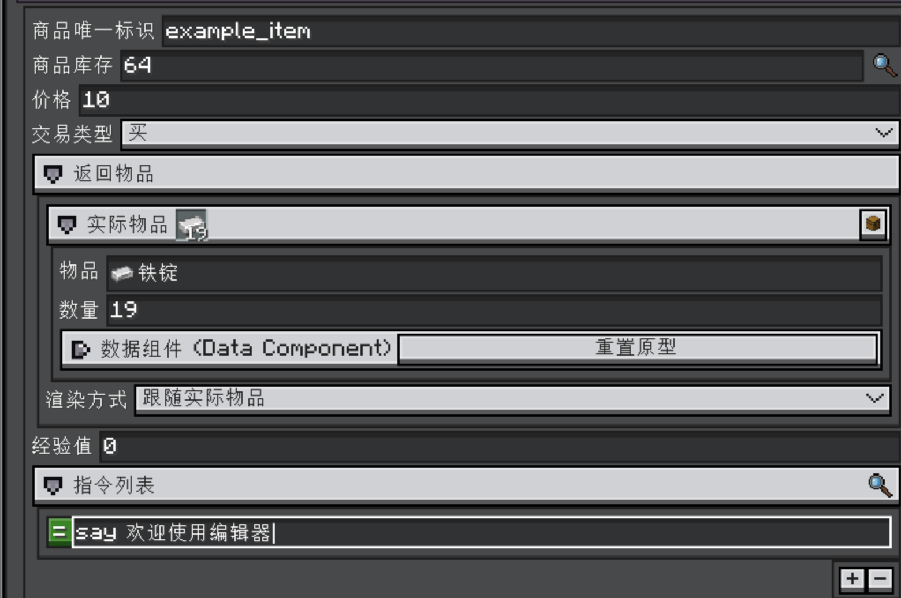
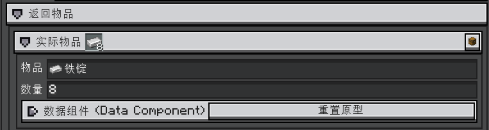
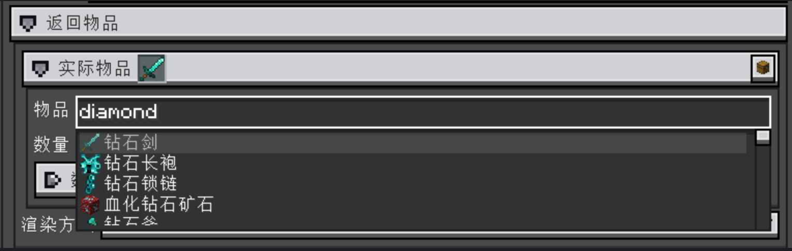
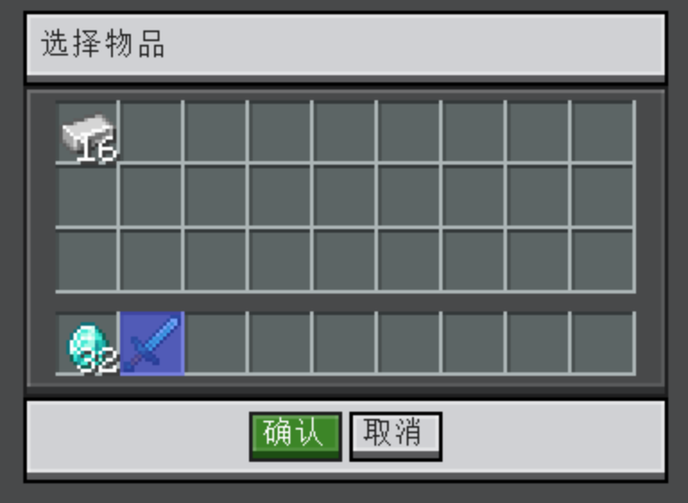
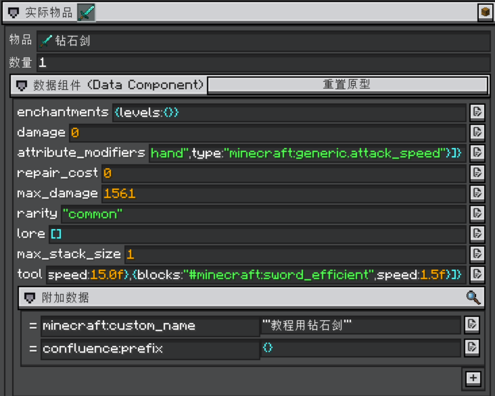
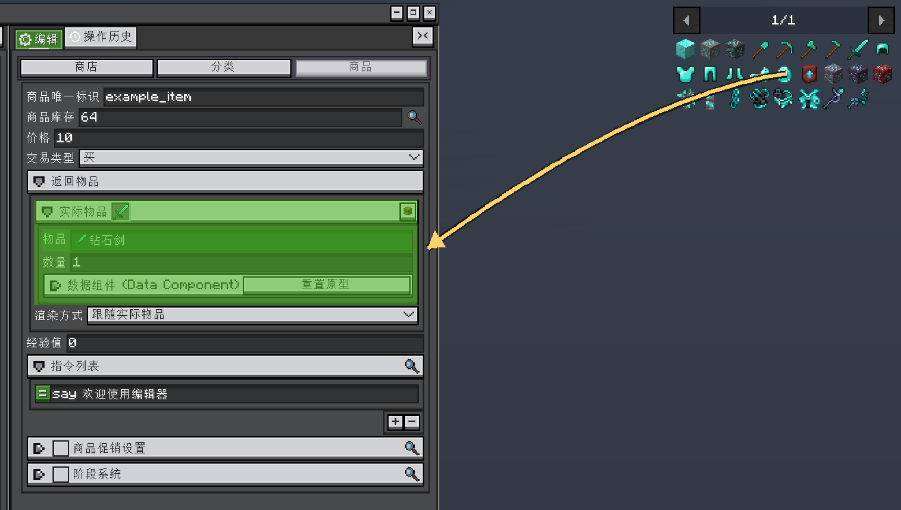
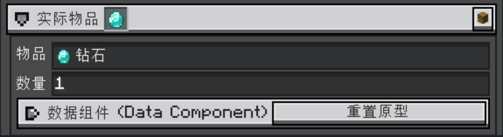
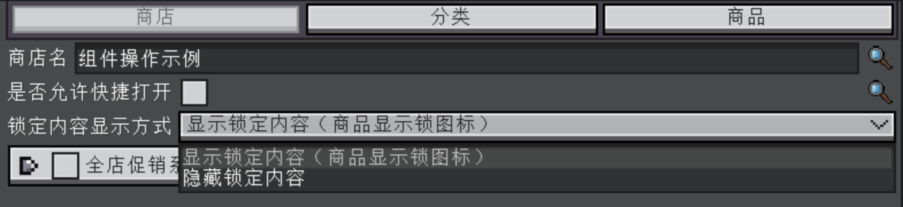

<h1 id="编辑器常用组件操作" data-toc-id="编辑器常用组件操作">编辑器常用组件操作</h1>

这些组件由多个系列编辑器共用。AI 设置里的文本框、开关和下拉框也遵循相同交互；可结合<a href="?file=&quot;AI.连接与权限设置&quot;">连接与权限设置</a>阅读。

ViScript 系列编辑器会共用 LDLib2 和 VSL 的表单组件。本页按常见组件介绍操作方法，包括物品搜索、背包取样、JEI
  拖拽、数字调节、开关、下拉选项、列表和字段复制。打开、保存、上传以及编辑器设置，另见<a
    href="?file=&quot;编辑器.基础操作&quot;">编辑器基础操作</a>。

附属模组可以限制输入范围、筛选候选项，或使用自己的组件；实际可执行的操作以该字段的提示和所属模组说明为准。

配图来自 VSS
  商店编辑器，使用示例分类和示例商品演示共用组件。图中的“返回物品”“商品库存”等是示例字段名；在其他编辑器中，找到相同类型的组件即可照着操作。商店交易规则、任务目标、配方类型等专属功能，由对应模组的教程介绍。

<h2 id="常用操作速查" data-toc-id="常用操作速查">常用操作速查</h2>
<table data-type="custom-table" data-with-header-row="true"
  style="min-width: 100px;">
  <tbody>
    <tr>
      <th>想完成的操作</th>
      <th>使用的组件或入口</th>
    </tr>
    <tr>
      <td>填写一个物品</td>
      <td>物品搜索框：输入名称或 ID，再点击候选项。</td>
    </tr>
    <tr>
      <td>复制背包中带名称、附魔的物品</td>
      <td>物品栈标题右侧的箱子按钮：选中后确认，或双击物品。</td>
    </tr>
    <tr>
      <td>从物品查询列表快速取样</td>
      <td>缩小编辑器，把 JEI／EMI／REI 图标拖到支持接收的物品字段。</td>
    </tr>
    <tr>
      <td>快速增减数量</td>
      <td>点击数字框后滚动滚轮，或按住数字文字左右拖动；Shift 加快调整。</td>
    </tr>
    <tr>
      <td>添加或删除一条配置</td>
      <td>展开列表，用 + 添加；先选中条目，再用 - 删除。</td>
    </tr>
    <tr>
      <td>调整列表顺序</td>
      <td>在允许排序的列表中，按住条目前的 = 手柄上下拖动。</td>
    </tr>
  </tbody>
</table>
<h2 id="数字输入框" data-toc-id="数字输入框">数字输入框</h2>

数量、概率、时间和坐标等字段通常使用数字框。除了直接键入数值，还可以用滚轮或左右拖动快速调整。

<table data-type="custom-table" data-with-header-row="true"
  style="min-width: 100px;">
  <tbody>
    <tr>
      <th>操作</th>
      <th>效果</th>
    </tr>
    <tr>
      <td>点击数字框后输入</td>
      <td>直接修改数值；需要整体替换时，可先用 Ctrl+A 全选。</td>
    </tr>
    <tr>
      <td>点击数字框，让鼠标保持在框内并滚动滚轮</td>
      <td>向上滚增加，向下滚减少。输入框需要获得焦点，只把鼠标移上去可能仍在滚动外层列表。</td>
    </tr>
    <tr>
      <td>按住 Shift 再滚动</td>
      <td>每次按当前步长的 10 倍调整，适合快速修改较大的数值。</td>
    </tr>
    <tr>
      <td>在数字文字上按住左键并左右拖动</td>
      <td>向右增加、向左减少；按住 Shift 可以加快调整。</td>
    </tr>
  </tbody>
</table>

默认整数步长通常是 <code>1</code>，小数步长通常是 <code>0.1</code>；具体字段可以设置自己的步长。例如步长为
  <code>1</code> 时，普通滚轮每次增减 <code>1</code>，按住 <code>Shift</code> 每次增减
  <code>10</code>。数值还需符合该字段的上下限和整数／小数要求。

输入框标记为无效时，当前文字可能尚未写入字段。请改为范围内的有效数值，再继续操作。

如果只是想滚动检查器，先点击数字框外的空白处，再把鼠标移到列表区域滚动。调整后检查单位：标为 <code>tick</code> 的时间通常按每秒
  <code>20 tick</code> 换算，具体含义以字段说明为准。

上图中的数量是数字框，下面的“指令列表”是列表组件。滚轮修改的是当前获得焦点的数字；列表的增删与排序见后面的<a
    href="#列表的添加删除与排序">列表操作</a>。

<h2 id="物品与物品栈字段" data-toc-id="物品与物品栈字段">物品与物品栈字段</h2>

选物品时，先分清字段保存的是“物品类型”还是“物品栈”。例如钻石剑的物品 ID 是
  <code>minecraft:diamond_sword</code>；它的数量、名称、附魔等属于物品栈的数据。

<table data-type="custom-table" data-with-header-row="true"
  style="min-width: 100px;">
  <tbody>
    <tr>
      <th>字段类型</th>
      <th>能修改的内容</th>
    </tr>
    <tr>
      <td>物品类型／物品 ID</td>
      <td>选择是哪一种物品；不包含数量和物品组件。</td>
    </tr>
    <tr>
      <td>物品栈</td>
      <td>选择物品，并按编辑器提供的字段设置数量和物品组件。</td>
    </tr>
    <tr>
      <td>物品标签</td>
      <td>选择一个标签 ID，代表一组符合标签的物品；候选图标可能轮播该标签内的物品。</td>
    </tr>
  </tbody>
</table>

  上图展开了“实际物品”：标题行显示当前物品，右侧箱子按钮用于从背包取样；内部依次是物品选择、数量和数据组件。先展开物品分组，才能看到详细字段。图标预览用于核对当前选择。

<h3 id="通过搜索选择" data-toc-id="通过搜索选择">通过搜索选择</h3>

点击带自动补全的物品框，输入完整 ID、ID 的一部分，或当前语言下的物品名称，例如
  <code>minecraft:stone</code>、<code>diamond</code>、“石头”。点击下拉候选项完成选择。关闭后显示
  ID，或显示物品名称与图标，取决于当前组件的展示方式。

选择标签时按标签 ID 搜索，例如 <code>minecraft:logs</code>；标签通常没有对应的本地化名称。输入中是否需要
  <code>#</code> 由字段格式决定，请按提示填写。标签中的轮播图标只是示例，选择后保存的是整个标签。

上图输入了 <code>diamond</code>，候选中会出现 ID
  或名称符合关键词的物品。<strong>输入关键词只是筛选，点击候选项才完成选择。</strong>只修改物品选择行不等同于重新导入一份完整物品栈；改成另一种物品后，也要检查数量和已有组件。

<h3 id="通过背包选择" data-toc-id="通过背包选择">通过背包选择</h3>

想直接使用背包里已经准备好的物品，点击物品栈标题行右侧的<strong>箱子图标</strong>。这个入口会打开背包选择窗口，显示主背包和快捷栏。

  

    
在背包中准备样本

    

      
把需要的物品放在主背包或快捷栏。如果配置需要自定义名称、附魔或其他物品数据，先把样本准备成最终状态。

    

  

  

    
打开选择窗口并选中物品

    

      
点击箱子按钮，再单击需要的物品。选中的格子会高亮，此时可以继续换选其他格子。

    

  

  

    
确认或双击快速选入

    

      
点击“确认”填写选中的物品栈。VSL
        中也可以<strong>双击一个非空物品格</strong>，直接确认并关闭窗口；点击“取消”则保留原值。最后核对物品、数量和组件。

    

  

图中选择了快捷栏里的钻石剑。这里执行的是<strong>复制物品数据</strong>，不会取走、移动或消耗背包中的物品，也不要求开启 JEI 作弊模式。

本例的样本名称为“教程用钻石剑”，选入后仍保留该名称。背包取样会复制整份物品栈，包括数量与来源携带的数据；只保存物品类型的字段，则只能记录是哪一种物品。

<h3 id="物品数据组件" data-toc-id="物品数据组件">物品数据组件</h3>

在 Minecraft 1.21.1 中，名称、附魔、耐久等信息属于物品的数据组件。标准物品栈表单提供“数据组件（Data
  Component）”分组，展开后可以查看当前物品的组件字段；“附加数据”列表用于添加原型之外的组件。不同组件的值可能需要继续展开或打开专用编辑框。

日常配置优先使用背包样本取样，再按需要调整数量。直接编辑组件值时，需要符合该组件要求的数据格式；组件 ID 和普通显示名称不是同一回事。

“重置原型”会重建当前物品原型的默认组件配置。它不是取消上一步选择；如果只是想换一个物品或恢复背包样本，应重新选择对应物品。

<h3 id="从-jeiemirei-拖拽选择物品" data-toc-id="从-jeiemirei-拖拽选择物品">从 JEI／EMI／REI
  拖拽选择物品</h3>

LDLib2 为 JEI、EMI、REI
  提供拖拽填写支持。安装并启用其中一个物品查询模组、且当前编辑界面能够显示它的物品列表时，可以从列表直接拖入物品。无需为了填写表单同时安装三者。

  

    
缩小编辑器，露出物品列表

    

      

        使用编辑器窗口的缩小／还原按钮，让编辑器保留在左侧，右侧露出物品列表。若编辑器使用其他窗口布局，按它提供的方式移动或缩小窗口。保持目标物品字段可见。
      

    

  

  

    
搜索需要的物品

    

      
在 JEI、EMI 或 REI 的搜索框中找到物品。拖拽前确认目标字段允许选择这种物品，例如方块选择字段只接受对应的方块物品。

    

  

  

    
把图标拖到物品字段上

    

      
按住物品列表中的图标，拖到编辑器内支持接收的物品选择框或物品栈表单区域，再松开鼠标。拖拽期间，查询模组可能会标出可接收的位置；JEI
        在本例中用绿色覆盖显示接收区域。

    

  

  

    
核对字段并保存

    

      
确认图标、物品 ID、数量和组件符合预期。完成选择后可还原编辑器窗口，并按该编辑器的流程保存项目；需要发布到服务器时再上传。

    

  

上图已经把右侧 JEI 列表中的钻石拖到物品表单上，绿色区域表示可以接收。沿箭头方向拖入，在绿色区域内松开鼠标即可填写。需要拖入的是查询列表中的物品图标。

松开后，本例的物品由钻石剑变成了钻石，数量为 <code>1</code>。JEI
  的普通物品列表提供的样本通常是一件物品；想配置其他数量，继续修改数量框即可。

  这是向表单<strong>填写物品数据</strong>，不会消耗物品，也不会因为拖进了编辑器就把物品发到玩家背包。物品栈字段会接收来源提供的物品栈，数量和组件可能随之改变；物品类型字段只取物品类型。选完后应检查实际结果，尤其是自定义名称、附魔和模组组件。

拖拽目标需要接入对应的兼容功能。LDLib2 标准物品栈表单和部分注册表选择器支持这项操作；自定义槽位是否支持取决于所属模组。普通文本框、标签 ID
  输入框和只读图标不能默认视为可接收目标。

<h2 id="注册表对象输入框" data-toc-id="注册表对象输入框">注册表对象输入框</h2>

对象预设用于选择游戏中已注册的一种内容，包括原版以及已加载模组提供的内容。下面按用途列出各类预设。名称搜索使用当前游戏语言；如果模组没有提供对应翻译，使用
  ID 或 ID 片段更容易找到目标。

<table data-type="custom-table" data-with-header-row="true"
  style="min-width: 100px;">
  <tbody>
    <tr>
      <th>预设输入框</th>
      <th>选择内容与候选预览</th>
      <th>搜索方式与示例</th>
    </tr>
    <tr>
      <td>物品</td>
      <td>选择物品类型，候选显示物品图标和名称。数量、名称、附魔等物品栈数据需要另行配置。</td>
      <td>按物品 ID 或名称搜索，例如 diamond、minecraft:diamond 或“钻石”。</td>
    </tr>
    <tr>
      <td>方块</td>
      <td>选择方块类型；有对应物品形态的方块会显示图标。方块状态属性由其他字段设置。</td>
      <td>按方块 ID 或名称搜索，例如 minecraft:stone 或“石头”。</td>
    </tr>
    <tr>
      <td>流体</td>
      <td>选择流体类型，候选显示可用的流体纹理。流体数量由其他字段设置。</td>
      <td>按流体 ID 或流体类型名称搜索，例如 minecraft:water 或“水”；同名流体可通过 ID 区分。</td>
    </tr>
    <tr>
      <td>实体类型</td>
      <td>选择一种实体，而不是世界中的某个具体实体。有对应刷怪蛋时，候选显示刷怪蛋图标。</td>
      <td>按实体 ID 或名称搜索，例如 minecraft:zombie 或“僵尸”。</td>
    </tr>
    <tr>
      <td>生物群系</td>
      <td>选择当前世界提供的生物群系。</td>
      <td>按生物群系 ID 或名称搜索，例如 minecraft:plains 或“平原”。</td>
    </tr>
    <tr>
      <td>结构</td>
      <td>选择结构类型，例如村庄；不用于查找某一座结构的坐标。</td>
      <td>按结构 ID、结构类型 ID 搜索，也支持把 ID 中的下划线换成空格，例如 village、village_plains 或 village plains。</td>
    </tr>
    <tr>
      <td>维度</td>
      <td>选择当前连接或服务器中已知的维度。</td>
      <td>按维度 ID 搜索，例如 minecraft:the_nether 或 the_nether；不支持用“下界”代替 ID 搜索。</td>
    </tr>
    <tr>
      <td>伤害类型</td>
      <td>选择火焰、摔落等伤害类型，候选显示伤害类型 ID。</td>
      <td>按 ID 搜索，例如 minecraft:in_fire；也能匹配对应死亡消息的标识及当前语言下的消息文本。</td>
    </tr>
    <tr>
      <td>属性</td>
      <td>选择最大生命值、攻击伤害等属性类型；属性数值由其他字段设置。</td>
      <td>按属性 ID 或名称搜索，例如 max_health 或“最大生命值”。</td>
    </tr>
    <tr>
      <td>附魔</td>
      <td>选择附魔类型，候选显示附魔书图标和附魔名称；附魔等级由其他字段设置。</td>
      <td>按附魔 ID 或名称搜索，例如 minecraft:sharpness 或“锋利”。</td>
    </tr>
    <tr>
      <td>状态效果</td>
      <td>选择速度、中毒等状态效果，候选显示效果图标和名称；持续时间、等级由其他字段设置。</td>
      <td>按效果 ID 或名称搜索，例如 minecraft:speed 或“速度”。</td>
    </tr>
    <tr>
      <td>声音事件</td>
      <td>选择游戏注册的声音事件。该预设用于选择声音，不提供试听按钮。</td>
      <td>按声音事件 ID 或声音资源位置搜索，例如 minecraft:item.bucket.empty 或 bucket.empty；不按中文名称搜索。</td>
    </tr>
    <tr>
      <td>粒子类型</td>
      <td>选择粒子类型；颜色、大小等额外参数取决于外层表单，不在候选列表中设置。</td>
      <td>按粒子 ID 搜索，例如 minecraft:flame 或 flame；也支持把 ID 中的下划线换成空格。</td>
    </tr>
  </tbody>
</table>

实体类型框可以被编辑器设置为<strong>只显示生物</strong>，或进一步限定为可由游戏 AI
  控制的生物类型；这类字段不会列出船、矿车等不符合条件的实体。其他对象预设也可以有筛选条件，因此两个看起来相同的输入框，候选范围不一定完全相同。

  生物群系、附魔、伤害类型等候选依赖当前世界的数据，维度也需要从当前连接或服务器中读取。未进入世界、尚未连接服务器或数据未同步完成时，候选可能不完整或为空。结构框在没有可用结构数据时可以提供内置候选；模组或数据包添加的结构仍需以实际加载的数据为准。

<h3 id="标签输入框" data-toc-id="标签输入框">标签输入框</h3>

需要选择“一组同类对象”时，可以使用标签预设。例如在物品标签框中选择
  <code>minecraft:planks</code>，表示选择该标签包含的木板，而不是只选橡木木板这一件物品。标签实际包含哪些成员，由当前模组和数据包共同决定。

  <strong>在 VSL 的标签预设中，搜索时输入标签 ID 或片段，不要加 </strong><code>#</code><strong>。</strong>例如输入
  <code>minecraft:planks</code> 或 <code>planks</code>，再点击候选项。其他配置格式中可能使用
  <code>#minecraft:planks</code>
  表示标签引用，但这里由组件负责记录选中的标签，不需要手动拼写引用格式。标签通常没有本地化名称，应按 ID 搜索。

<table data-type="custom-table" data-with-header-row="true"
  style="min-width: 100px;">
  <tbody>
    <tr>
      <th>预设输入框</th>
      <th>选择内容与候选预览</th>
    </tr>
    <tr>
      <td>物品标签</td>
      <td>选择一组物品；候选可以轮播标签成员的物品图标。</td>
    </tr>
    <tr>
      <td>方块标签</td>
      <td>选择一组方块；候选可以显示成员对应的方块物品图标。</td>
    </tr>
    <tr>
      <td>流体标签</td>
      <td>选择一组流体；候选可以轮播成员的流体纹理。</td>
    </tr>
    <tr>
      <td>实体类型标签</td>
      <td>选择一组实体类型；成员有对应刷怪蛋时，可以显示刷怪蛋图标。</td>
    </tr>
    <tr>
      <td>生物群系标签</td>
      <td>选择当前世界中的一组生物群系，候选按标签 ID 显示。</td>
    </tr>
    <tr>
      <td>结构标签</td>
      <td>选择一组结构，候选按标签 ID 显示；没有可用条目时会提供内置结构标签候选。</td>
    </tr>
    <tr>
      <td>伤害类型标签</td>
      <td>选择当前世界中的一组伤害类型，候选按标签 ID 显示。</td>
    </tr>
    <tr>
      <td>附魔标签</td>
      <td>选择当前世界中的一组附魔；候选可以显示成员的附魔书图标。</td>
    </tr>
  </tbody>
</table>

物品标签和方块标签属于不同类型，即使 ID
  相同也不能混用。候选的轮播图标只是成员预览，不一定展示全部成员；点击后选中的是<strong>整个标签</strong>，不会只选中当时正在显示的那件物品。没有图标也不一定表示标签无效，有些类型只显示文字，或者没有可用于预览的成员图标。

<h3 id="数据包与资源包文件输入框" data-toc-id="数据包与资源包文件输入框">数据包与资源包文件输入框</h3>

VSL 还提供通用 JSON 资源文件预设，以及数据包文件、资源包文件两种预设。它们用于引用游戏已加载的 JSON
  资源。编辑器会预先指定搜索目录，你只需要输入资源 ID 或文件名片段，再选择候选；这里不会浏览电脑上的任意文件，也不搜索 JSON 文件正文。

<table data-type="custom-table" data-with-header-row="true"
  style="min-width: 100px;">
  <tbody>
    <tr>
      <th>预设输入框</th>
      <th>候选来源</th>
      <th>使用时注意</th>
    </tr>
    <tr>
      <td>通用 JSON 资源文件</td>
      <td>编辑器指定的资源来源和目录。</td>
      <td>只列出该范围内已加载的 JSON 文件，具体用途以字段说明为准。</td>
    </tr>
    <tr>
      <td>数据包文件</td>
      <td>当前服务器已加载的数据包中，指定目录下的 JSON 文件。</td>
      <td>需要读取到服务器数据；联机时还取决于该编辑界面是否接入了服务器端搜索。</td>
    </tr>
    <tr>
      <td>资源包文件</td>
      <td>当前客户端已加载的资源中，指定目录下的 JSON 文件。</td>
      <td>目标资源包需要已启用并加载；PNG 贴图和 OGG 声音文件不属于这种 JSON 文件预设的候选。</td>
    </tr>
  </tbody>
</table>

  候选和选择结果使用<strong>去掉 </strong><code>.json</code><strong> 后缀的资源 ID</strong>，但保留资源路径中的目录。例如，假设某字段搜索
  <code>chatbox/dialogues</code> 目录，数据包中的
  <code>data/test/chatbox/dialogues/example.json</code> 会显示为
  <code>test:chatbox/dialogues/example</code>。可以搜索 <code>example</code> 或这个完整
  ID，无需把 <code>data/</code> 和 <code>.json</code> 一起填入。

资源包文件同理，例如 <code>assets/minecraft/shaders/post/invert.json</code> 对应
  <code>minecraft:shaders/post/invert</code>。它只有在当前字段的搜索目录覆盖该路径、且客户端确实加载了该文件时，才会出现在候选中。

<h3 id="缺失物品-id-输入框" data-toc-id="缺失物品-id-输入框">缺失物品 ID 输入框</h3>

在处理项目中的缺失物品时，编辑器还可以使用专门的缺失物品 ID
  预设。它只列出<strong>当前项目已经记录的缺失物品 ID</strong>，用于定位需要处理的旧引用。可以输入模组命名空间、路径片段或完整 ID
  搜索，再点击候选项。

这个框不会列出游戏中的全部正常物品，也不能通过随意输入一个新 ID
  来增加候选。需要选择替代物品时，应使用该操作另外提供的普通物品选择框；是否执行替换、如何保存，按所属编辑器的提示操作。

<h2 id="开关与下拉选项" data-toc-id="开关与下拉选项">开关与下拉选项</h2>

  <strong>开关</strong>用来选择启用或关闭，点击方框或开关本体切换。有些分组的标题同时带有展开箭头和开关：箭头控制是否展开参数，开关控制这项功能是否启用，两者含义不同。折叠起来不代表功能已关闭。

  <strong>下拉选择器</strong>用于从固定选项中选择一种模式。点击当前值或右侧箭头打开列表，再点击目标选项。它和自动补全搜索框不同，不能随意填入候选之外的值。切换模式后，关联字段可能随之出现或隐藏。

图中的“是否允许快捷打开”是开关，“锁定内容显示方式”是下拉选项。这里只演示组件操作，具体选项的业务含义请看对应模组说明。

<h2 id="列表的添加删除与排序" data-toc-id="列表的添加删除与排序">列表的添加、删除与排序</h2>

需要配置多个物品、指令、条件或规则时，通常会使用列表。先展开列表分组，再操作里面的条目。

<table data-type="custom-table" data-with-header-row="true"
  style="min-width: 100px;">
  <tbody>
    <tr>
      <th>操作</th>
      <th>方法</th>
    </tr>
    <tr>
      <td>添加一项</td>
      <td>点击列表末尾的 +。新条目一般使用默认值，添加后还要填写内容。</td>
    </tr>
    <tr>
      <td>编辑一项</td>
      <td>点击条目里的输入框或展开其分组；一项也可能包含多个字段。</td>
    </tr>
    <tr>
      <td>删除一项</td>
      <td>先点击目标条目使它选中，再点击列表末尾出现的 -。删除按钮针对当前选中项。</td>
    </tr>
    <tr>
      <td>调整顺序</td>
      <td>按住条目左侧的 = 手柄，上下拖到需要的位置后松开。</td>
    </tr>
  </tbody>
</table>

  只有列表允许对应操作时，才会出现或启用这些控件。看不到减号时，先选中条目；如果该条目禁止删除，仍不会显示删除入口。想滚动列表时使用滚轮或滚动条；按住等号手柄拖动会调整条目顺序。

<h2 id="颜色选择器" data-toc-id="颜色选择器">颜色选择器</h2>

遇到颜色预览块时，点击色块打开调色板。在调色板中选颜色，可以调整色相、透明度，或输入 RGB 数值。带 <code>#</code> 的八位颜色框采用
  <code>#AARRGGBB</code>：前两位是透明度，后六位是红、绿、蓝，例如 <code>#ff55aaff</code>
  表示完全不透明的蓝色。颜色很淡或完全看不见时，也要检查透明度。

如果当前字段只提供普通文本输入，则按它自己的格式提示填写；不要把所有颜色字段都当成相同格式。

<h2 id="文本编辑与字段复制" data-toc-id="文本编辑与字段复制">文本编辑与字段复制</h2>

在文本框中，可以用 <code>Ctrl/Cmd+A</code> 全选、<code>Ctrl/Cmd+C</code>
  复制、<code>Ctrl/Cmd+X</code> 剪切、<code>Ctrl/Cmd+V</code>
  粘贴。此时操作的是文本框中的文字；想对画布对象执行复制等操作时，先把焦点移回对应视图。

部分 LDLib2
  字段还提供右键菜单，可以复制整个字段值，再粘贴到兼容类型的字段中。这种字段复制使用编辑器内部的类型化剪贴板，和复制一段文字不同；只有组件提供该功能、且目标类型兼容时，才会显示相应菜单。

字段改动会更新当前项目，最后仍需按照<a href="?file=&quot;编辑器.基础操作&quot;">文件菜单的通用操作</a>保存。

相关教程：<a href="?file=&quot;学习路线&quot;">学习路线</a> · <a href="?file=&quot;编辑器.基础操作&quot;">基础操作</a> · <a href="?file=&quot;编辑器.独立窗口与布局&quot;">独立窗口与布局</a> · <a href="?file=&quot;AI.连接与权限设置&quot;">连接与权限设置</a> · <a href="?file=&quot;排错与数据保存&quot;">排错与数据保存</a>

