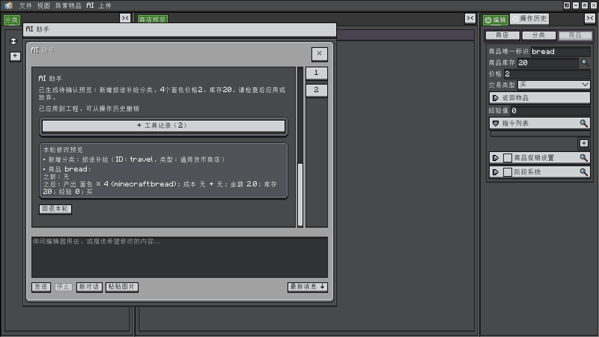

<h1 id="ai-chat-and-images" data-toc-id="ai-chat-and-images">AI chat and images</h1>

After <a href="?file=&quot;AI.Connection and Edit Preferences&quot;">connection setup</a>, choose AI → Open AI chat window. Chat normally uses its own desktop window, with an in-editor dialog fallback when native windows are unavailable.

<h2 id="window-and-messages" data-toc-id="window-and-messages">Window and messages</h2>

Move or resize the chat window as needed. Opening it again focuses the same window and retains its session. Type a message and press Send; Stop is available while generating. Editing a draft message or pasting an image does not send it immediately.

User messages appear on the right and assistant replies on the left. Replies render common Markdown elements such as headings, lists, code blocks and tables. Select displayed reply text and use Ctrl/Cmd+C to copy it. The small user-message copy button copies its original text.

<h2 id="paste-images" data-toc-id="paste-images">Paste images</h2>

Copy an image

Copy an image in the operating system, then use Ctrl+V / Cmd+V in the chat input or the Paste image button.

Inspect attachments

A pending thumbnail appears before sending. Remove attachments individually. Image-only, text-with-images and multiple-image messages are supported.

Send deliberately

Choose a service and model that accept image input, then Send. Thumbnail resizing does not change the original PNG dimensions or transparency sent to the service.

Follow up or clear

Later messages retain image context in this session. New chat clears it. Images are not stored in the project or preferences.

macOS and Windows use the native system clipboard. Linux desktop sessions need <code>wl-paste</code> for Wayland or <code>xclip</code> for X11. A successful paste establishes attachment availability; image understanding still depends on the model service.

<h2 id="read-tools-and-navigate-turns" data-toc-id="read-tools-and-navigate-turns">Read tools and navigate turns</h2>

Expand a turn’s tool records to check which project data, item IDs or tags were queried and which values actually changed. Turn-navigation buttons jump between exchanges; Latest messages returns to the bottom. Reading an earlier message does not force scrolling back down on every tool response.

Status labels report phases such as reasoning or querying; they do not expose private reasoning text. Continued body, reasoning-data or tool-argument progress can keep a request running beyond the idle-timeout interval. Heartbeats alone do not extend it indefinitely.

<h2 id="stop-close-and-start-a-new-chat" data-toc-id="stop-close-and-start-a-new-chat">Stop, close and start a new chat</h2>
<table data-type="custom-table" data-with-header-row="true" style="min-width: 100px;">
<tbody>
<tr><th>Action</th><th>While generating</th><th>Existing results</th></tr>
<tr><td>Stop</td><td>Cancels the request and drops the generating draft.</td><td>Applied project edits remain.</td></tr>
<tr><td>Close chat</td><td>Stops an active request.</td><td>A pending main-editor preview remains available for apply/discard; applied edits remain.</td></tr>
<tr><td>New chat</td><td>Clears conversation context and retracts an unconfirmed preview.</td><td>Applied native history remains.</td></tr>
<tr><td>Close the owning editor</td><td>Ends the session and retracts an unconfirmed preview.</td><td>Handle unsaved applied edits through the editor’s close workflow.</td></tr>
</tbody>
</table>

Messages and attachments live in the editor session’s memory. Save durable content in the project and copy important text separately. Continue with <a href="?file=&quot;AI.Preview Apply and Undo&quot;">Preview Apply and Undo</a>.

Related guides: <a href="?file=&quot;Learning Path&quot;">Learning Path</a> · <a href="?file=&quot;Editor-Basics&quot;">Editor-Basics</a> · <a href="?file=&quot;Editor.Desktop Windows and Layout&quot;">Desktop Windows and Layout</a> · <a href="?file=&quot;AI.Connection and Edit Preferences&quot;">Connection and Edit Preferences</a> · <a href="?file=&quot;Troubleshooting and Saving&quot;">Troubleshooting and Saving</a>

