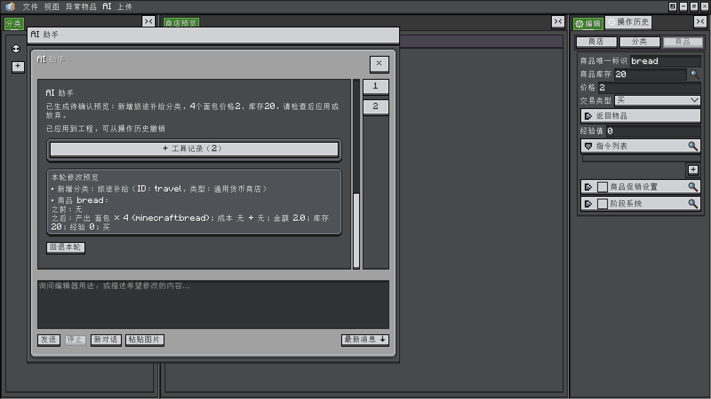

<h1 id="ai-对话与图片" data-toc-id="ai-对话与图片">AI 对话与图片</h1>

完成<a href="?file=&quot;AI.连接与权限设置&quot;">连接设置</a>后，从顶部“AI → 打开 AI 对话窗口”开始。聊天默认在独立桌面窗口中打开，平台不支持时回退到编辑器内浮窗。

<h2 id="窗口与基本操作" data-toc-id="窗口与基本操作">窗口与基本操作</h2>

独立聊天窗口可以拖动、缩放；再次打开会聚焦同一窗口并保留当前会话。输入问题后点击“发送”，生成时可以“停止”。只修改输入文字或粘贴图片，不会立即发送。

玩家消息在右侧，AI 回复在左侧。回复可以显示标题、列表、代码块和表格等常用 Markdown 样式。可拖选显示文本，用 <code>Ctrl/Cmd+C</code> 复制；玩家消息的小按钮复制原始全文。

<h2 id="粘贴图片" data-toc-id="粘贴图片">粘贴图片</h2>

复制图片

在系统中复制需要讨论的图片，回到聊天输入框按 Ctrl+V / Cmd+V，或点击“粘贴图片”。

检查待发送附件

图片先成为缩略图，可逐张移除；可以只发图片、文字配图，或同条消息包含多张图片。

主动发送

确认所选模型与服务支持图片输入，再点击“发送”。缩略图大小不影响发送 PNG 的原始尺寸和透明度。

追问与清理

后续消息保留本会话中的历史图片上下文。“新对话”会清除这些上下文；图片不写入工程或设置。

macOS 与 Windows 使用系统原生剪贴板。Linux 桌面需要可用的 <code>wl-paste</code>（Wayland）或 <code>xclip</code>（X11）。图片能进入输入区，只表示粘贴成功；模型是否能理解图片取决于服务和模型能力。

<h2 id="阅读工具记录和长对话" data-toc-id="阅读工具记录和长对话">阅读工具记录和长对话</h2>

展开一轮的工具记录，可以核对它读取了哪个工程、查询了哪些物品或标签，以及实际旧值和新值。右侧轮次按钮可跳到指定问答，“最新消息”返回末尾；停留在较早消息时，工具返回不会强制把阅读位置拉走。

“正在推理”“正在查询”等状态说明当前处理阶段，不代表会展示模型内部推理正文。收到持续的正文、推理数据或工具参数时，请求可以超过无响应超时的秒数；只有心跳而没有有效进展时仍会结束等待。

<h2 id="停止关闭和新对话" data-toc-id="停止关闭和新对话">停止、关闭和新对话</h2>
<table data-type="custom-table" data-with-header-row="true" style="min-width: 100px;">
<tbody>
<tr><th>操作</th><th>对生成中的草稿</th><th>对已存在结果</th></tr>
<tr><td>停止生成</td><td>停止请求并丢弃尚在生成的草稿。</td><td>已应用的工程修改仍保留。</td></tr>
<tr><td>关闭聊天窗口</td><td>停止仍在进行的请求。</td><td>主编辑器已有的待确认预览仍可应用或放弃；已应用修改保留。</td></tr>
<tr><td>新对话</td><td>清理会话上下文，并撤回未确认预览。</td><td>已应用的原生历史仍在。</td></tr>
<tr><td>关闭所属编辑器</td><td>结束其会话并撤回未确认预览。</td><td>已应用但未保存的内容仍须按编辑器关闭提示处理。</td></tr>
</tbody>
</table>

聊天记录和附件随编辑器会话保存在内存中；需要长期保留的结果应写入工程并保存，重要文字请另行复制。下一步阅读<a href="?file=&quot;AI.预览应用与整轮撤销&quot;">预览应用与整轮撤销</a>。

相关教程：<a href="?file=&quot;学习路线&quot;">学习路线</a> · <a href="?file=&quot;编辑器.基础操作&quot;">基础操作</a> · <a href="?file=&quot;编辑器.独立窗口与布局&quot;">独立窗口与布局</a> · <a href="?file=&quot;AI.连接与权限设置&quot;">连接与权限设置</a> · <a href="?file=&quot;排错与数据保存&quot;">排错与数据保存</a>

