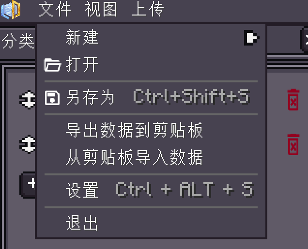

<h1 id="writing-shop-files-with-ai" data-toc-id="writing-shop-files-with-ai">Writing Shop Files with AI</h1>
The shop editor includes an AI assistant that can read the local project, discuss changes, and preview edits. Clipboard JSON import and export are still available for external tools. Both workflows ultimately save a <code>.shop</code> file.
<h2 id="configure-the-built-in-assistant" data-toc-id="configure-the-built-in-assistant">Configure the Built-in Assistant</h2>
Open <code>/viscript_shop editor</code> and create or load a shop. Open the editor settings and select <code>AI</code>, configure your model service, then use <code>AI → Open AI Chat</code> in the top menu.
<table data-type="custom-table" data-with-header-row="true" style="min-width: 100px;"><tbody><tr><th>Setting</th><th>What to enter</th></tr><tr><td>Enable AI</td><td>Off by default; enable before use</td></tr><tr><td>Service address</td><td>The HTTP/HTTPS endpoint of your model service; the local default is http://127.0.0.1:11434/v1 and does not install or start a model</td></tr><tr><td>API protocol</td><td>Auto, OpenAI, or Anthropic, matching the service</td></tr><tr><td>Model</td><td>An actual model name offered by the service; blank by default</td></tr><tr><td>API key</td><td>As required by the service; stored only in local editor settings, not uploaded with the shop project</td></tr><tr><td>Allow project editing</td><td>Enable for AI edits to the open shop; off by default</td></tr><tr><td>Confirm before applying</td><td>On by default; review the preview before applying</td></tr></tbody></table>
Sending a message makes a request to the configured model service. You can first ask it to read the shop and describe its plan before requesting edits. Your service may charge for requests; only send project data or screenshots you intend to share with it.
<h2 id="review-and-apply-one-turn" data-toc-id="review-and-apply-one-turn">Review and Apply One Turn</h2><pre language="plaintext" isclosed="false"><code class="language-plaintext">Read the current shop first. Do not remove existing categories.
Add a currency category with ID basic_resources, named Basic Resources.
Add offer diamond: buy 1 minecraft:diamond for 10 currency, unlimited stock (-1).
Preserve existing promotions, phases, and commands, and describe the changes.</code></pre><ol><li>
Send the request and wait for the assistant to inspect the project and propose edits.
</li><li>
Review the categories, items, counts, trade direction, prices, and stock in the editor preview. You can switch categories while reviewing; this preview has not been published.
</li><li>
Choose Apply Turn to keep the changes, or Discard Changes to restore the project. Applied changes support editor history undo/redo and Revert Turn.
</li><li>
Save or upload the shop yourself and test a purchase. The assistant does not automatically upload the shop or change server runtime data.
</li></ol><h2 id="supported-edits" data-toc-id="supported-edits">Supported Edits</h2><table data-type="custom-table" data-with-header-row="true" style="min-width: 100px;"><tbody><tr><th>AI can edit</th><th>Configure manually</th></tr><tr><td>Shop name and quick opening</td><td>Server upload and runtime application</td></tr><tr><td>Add, rename, and remove categories; choose new category types</td><td>Complex promotions, phase restrictions, and purchase commands</td></tr><tr><td>Add, update, and remove offers; item IDs and counts</td><td>Custom item components, NBT, and complex matching rules</td></tr><tr><td>Money prices, BUY/SELL direction, stock, and experience</td><td>Custom extension fields not exposed to the assistant</td></tr></tbody></table>
Unsupported existing fields are preserved. Use registered item IDs rather than display names, and unique, stable IDs for new categories and offers. Continue editing custom components, promotions, and phases in the inspector.
<h2 id="exchange-clipboard-json-with-external-tools" data-toc-id="exchange-clipboard-json-with-external-tools">Exchange Clipboard JSON with External Tools</h2>
After creating or loading a project, use Export Data to Clipboard in the File menu, edit the full JSON with an external tool, then use Import Data from Clipboard. Import replaces the project content: save a backup first and check categories, offers, prices, stock, and components afterwards. JSON is an exchange format; the runtime shop remains a <code>.shop</code> file.

Select a category again after import and verify its preview, including category IDs, offer IDs, actual items, and trade directions.
<h2 id="check-the-source-structure" data-toc-id="check-the-source-structure">Check the Source Structure</h2>
For external tools, provide JSON exported from your own current project and compare it with <code>ShopInfo</code>, <code>CategoryInfo</code>, <code>MerchantInfo</code>, and <code>ItemMatchRule</code> from the matching source. Do not invent fields.

See <a href="?file=&quot;Quick-Start.Your-First-Shop&quot;">Your First Shop</a> for creation and upload, and <a href="?file=&quot;Editor-Tutorial.Items-and-Trades&quot;">Items and Trades</a> for trade and component rules.

