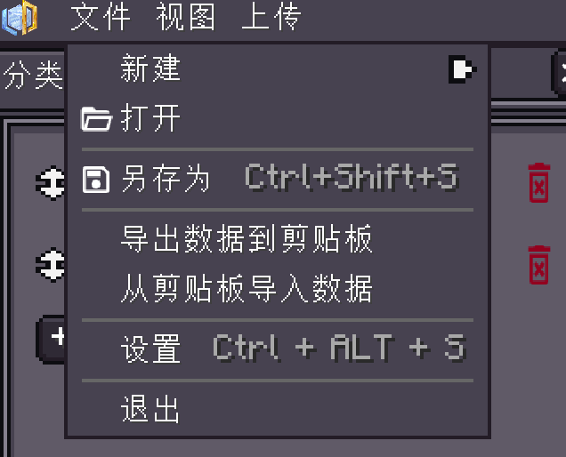

<h1 id="如何使用-ai-编写商店文件" data-toc-id="如何使用-ai-编写商店文件">如何使用 AI 编写商店文件</h1>
当前商店编辑器可以通过内置 AI 助手对话、读取本地工程并预览修改。若只是希望用外部工具批量修改，仍可使用剪贴板 JSON 导入与导出。两种方式最后都保存为 <code>.shop</code> 文件。
<h2 id="配置内置-ai-助手" data-toc-id="配置内置-ai-助手">配置内置 AI 助手</h2>
先打开 <code>/viscript_shop editor</code> 并新建或载入商店。进入编辑器设置的 <code>AI</code> 页面，填写自己使用的模型服务；再通过顶部 <code>AI → 打开 AI 对话窗口</code> 进入对话。
<table data-type="custom-table" data-with-header-row="true" style="min-width: 100px;"><tbody><tr><th>设置</th><th>填写或选择方式</th></tr><tr><td>启用 AI</td><td>默认关闭，使用前开启</td></tr><tr><td>服务地址</td><td>填写模型服务提供的 HTTP/HTTPS 接口地址；本地默认值为 http://127.0.0.1:11434/v1，不会自动安装或启动模型</td></tr><tr><td>API 协议</td><td>自动、OpenAI 或 Anthropic；按服务实际协议选择</td></tr><tr><td>模型</td><td>填写服务端实际提供的模型名称，默认留空</td></tr><tr><td>API 密钥</td><td>按服务要求填写，仅保存在本机编辑器设置，不随商店工程上传</td></tr><tr><td>允许编辑工程</td><td>需要 AI 修改当前商店时开启，默认关闭</td></tr><tr><td>应用前确认</td><td>默认开启，先检查修改预览再应用</td></tr></tbody></table>
点击“发送”后，请求会发送给设置中的模型服务。可先让 AI 只读取商店结构并说明修改计划，确认商品与分类后再让它编辑。模型服务可能计费；不要把不希望提供给该服务的数据或截图放入对话。
<h2 id="完成一轮可检查的修改" data-toc-id="完成一轮可检查的修改">完成一轮可检查的修改</h2>
可以直接使用下面的需求作为起点。这里的物品 ID 和价格是具体示例，不要求粘贴 JSON：
<pre language="plaintext" isclosed="false"><code class="language-plaintext">先读取当前商店，不要删除已有分类。
新增通用货币分类：ID 为 basic_resources，名称为基础资源。
添加商品 diamond：10 货币买 1 颗 minecraft:diamond，库存 -1。
保留现有促销、阶段和指令配置，并说明你修改了哪些内容。</code></pre><ol><li>
发送需求，等待 AI 读取当前工程并提出修改。
</li><li>
在编辑器预览中检查分类、商品、数量、交易方向、价格和库存。预览期间可切换分类查看，不要把预览当作已发布内容。
</li><li>
确认后点击“应用本轮”；不满意则点击“放弃修改”恢复原工程。已应用的修改可从操作历史撤销、重做，也可使用“回退本轮”。
</li><li>
最后自行保存或上传商店，并在玩家商店中验证成交结果。AI 助手不会自动上传商店或改变服务端运行数据。
</li></ol><h2 id="当前支持哪些修改" data-toc-id="当前支持哪些修改">当前支持哪些修改</h2><table data-type="custom-table" data-with-header-row="true" style="min-width: 100px;"><tbody><tr><th>可由 AI 修改</th><th>仍需手动配置</th></tr><tr><td>商店名称、是否允许快捷打开</td><td>服务端上传与运行时应用</td></tr><tr><td>添加、重命名、删除分类；指定新分类类型</td><td>复杂促销、阶段限制和成交指令</td></tr><tr><td>添加、修改、删除商品；物品 ID 与数量</td><td>自定义物品组件、NBT 和复杂匹配规则</td></tr><tr><td>货币价格、买卖方向、库存、经验</td><td>未提供给助手的自定义扩展字段</td></tr></tbody></table>
未支持字段会保留原有值。让 AI 使用有效的注册物品 ID，不要把显示名称当成注册 ID；新增分类或商品使用唯一且稳定的 ID。自定义组件、促销与阶段继续通过右侧配置面板编辑。
<h2 id="用剪贴板-json-与外部工具交换" data-toc-id="用剪贴板-json-与外部工具交换">用剪贴板 JSON 与外部工具交换</h2>
创建或载入工程后，在“文件”菜单中使用“导出数据到剪贴板”，把完整 JSON 交给外部工具修改；修改完成后使用“从剪贴板导入数据”。导入会替换当前工程内容，应先保存备份，再检查分类、商品、价格、库存和组件。JSON 是数据交换格式，运行时商店仍保存为 <code>.shop</code>。

导入后重新选择分类，检查预览是否与导入数据一致。不要只比较商品名称；同时核对分类 ID、商品 ID、实际物品和交易方向。
<h2 id="从源码核对结构" data-toc-id="从源码核对结构">从源码核对结构</h2>
需要外部工具理解完整格式时，优先提供自己从当前工程导出的 JSON，并对照同一套源码中的 <code>ShopInfo</code>、<code>CategoryInfo</code>、<code>MerchantInfo</code> 与 <code>ItemMatchRule</code>。不要凭空添加字段。

基础创建与上传步骤见<a href="?file=&quot;快速开始.创建第一个商店&quot;">创建第一个商店</a>；交易与组件规则见<a href="?file=&quot;编辑器教程.商品与交易&quot;">商品与交易</a>。

